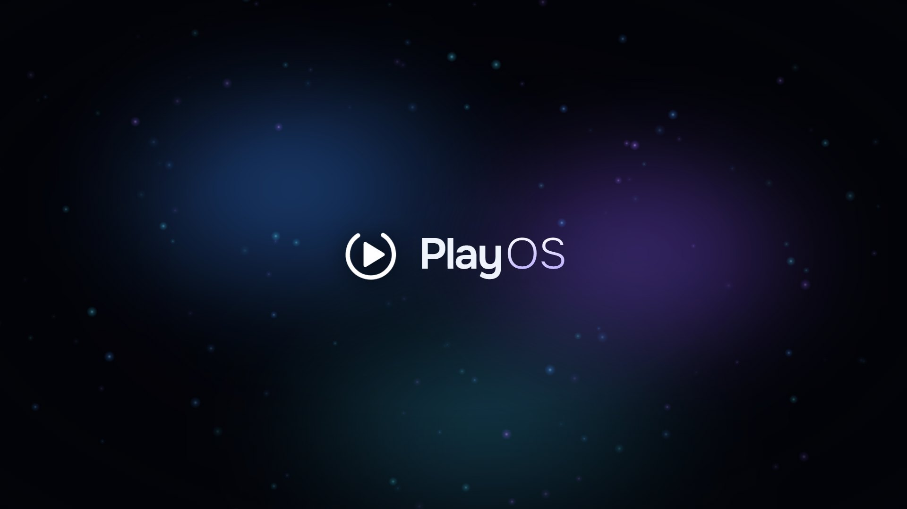
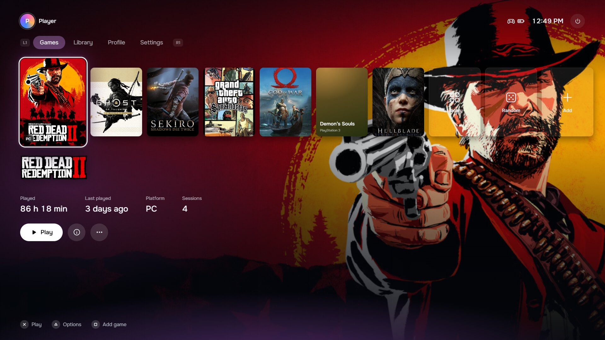
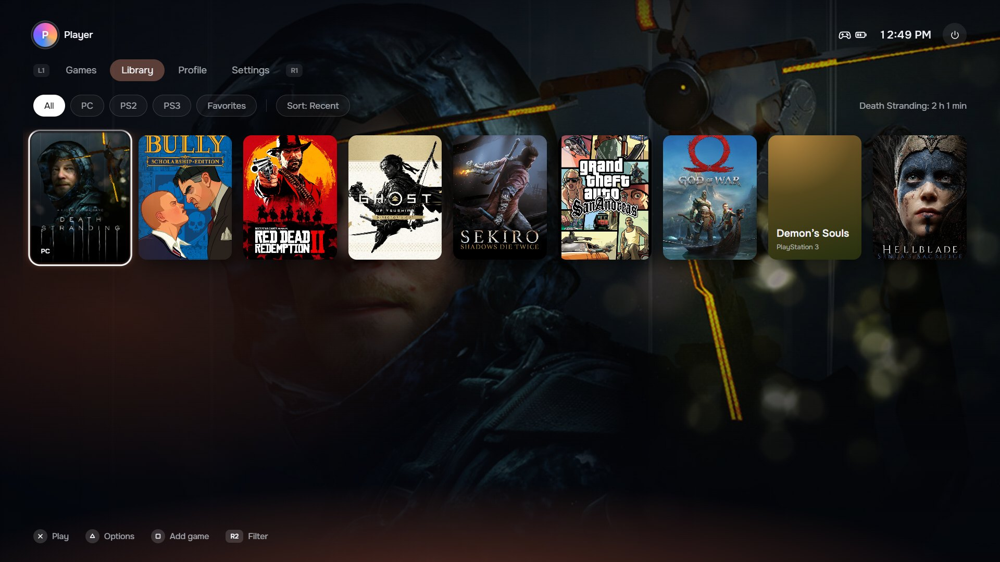
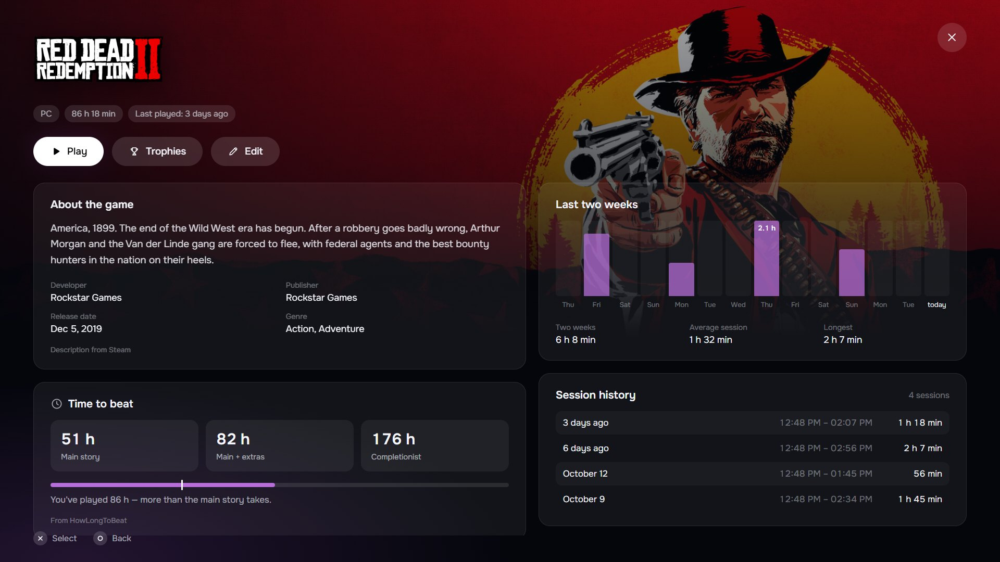
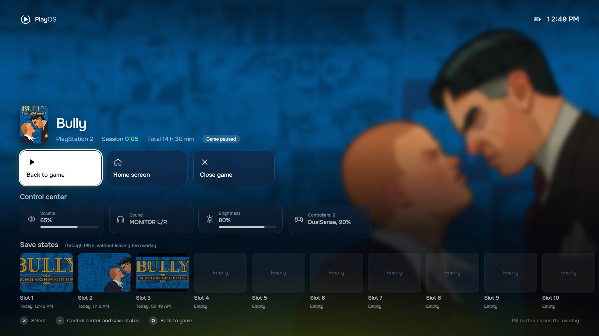
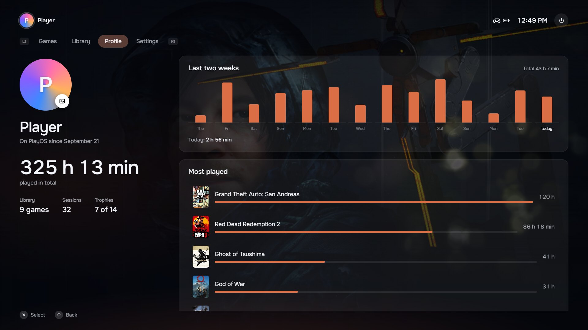
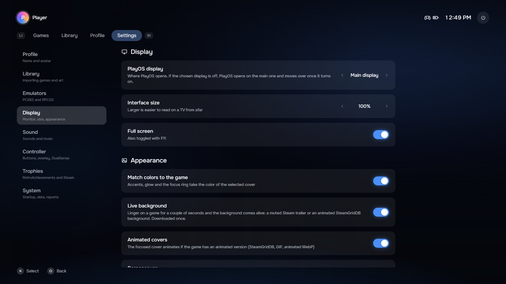
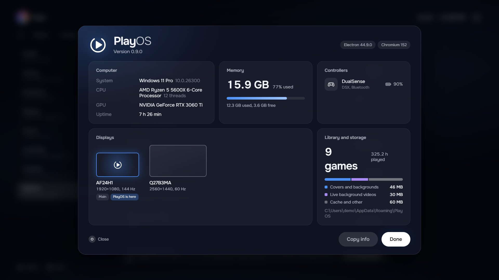

<p align="center">
  
</p>

<h1 align="center">PlayOS</h1>

<p align="center"><b>Turn your PC into a console.</b></p>

<p align="center">
  PC, PlayStation 2 and PlayStation 3 games in one library.<br>
  Pick a cover with your controller and play. On a monitor, a TV or over Moonlight.
</p>

<p align="center"><b>English</b> · <a href="README.md">Русский</a></p>

<p align="center">
  <a href="https://github.com/fakem1nk/PlayOS/releases/latest"><b>Download for Windows</b></a>
  &nbsp;·&nbsp;
  <a href="#features">Features</a>
  &nbsp;·&nbsp;
  <a href="docs/FAQ.en.md">FAQ and troubleshooting</a>
  &nbsp;·&nbsp;
  <a href="#found-a-bug">Found a bug</a>
  &nbsp;·&nbsp;
  <a href="#for-developers">For developers</a>
</p>

<br>

## Why

PC games live in different places: Steam, emulators, folders full of disc images. To play from the couch, you end up walking back to the mouse.

PlayOS gathers everything into one library and gives it a console interface. Turn it on, pick a cover, play. Play time, trophies and save states are all there. No mouse needed.

<br>

## Home screen

Your recent games in one row. The background, menu color and controller light bar follow the cover in focus, and if you linger, the background comes alive with a trailer.



<br>

## The whole library

Steam games are found automatically, PS2 images are recognized by their disc serial, and PS3 games come in from RPCS3. Filter by platform and favorites, sort by play time.



<br>

## Game page

A description, the time to beat from HowLongToBeat and how much of it you've played, your activity over two weeks and every session.



<br>

## Over any game

The PS button opens a menu right inside the game. The game pauses, and next to it you get emulator save states with screenshots, volume, audio output, brightness and controller battery.



<br>

## Profile and trophies

How much you've played and what you play most. Real trophies — RetroAchievements for PS2 and Steam achievements for PC — with notifications right over the game.



<br>

## Settings

Everything works with the D-pad: display and interface size for your TV, sound, controller, emulators. System info in one window.

<table>
  <tr>
    <td width="50%"></td>
    <td width="50%"></td>
  </tr>
</table>

<br>

## Features

**Library**
- PC (EXE files and Steam games), PlayStation 2 through PCSX2, PlayStation 3 through RPCS3
- Covers, backgrounds and logos from Steam, SteamGridDB and Wikipedia, animated covers
- Play time tracked per session, even when a game starts through its own launcher

**While playing**
- An in-game menu on the PS button, Guide or Ctrl + Alt + H, with the game paused
- PCSX2 save states to the slot you want, without switching windows
- Trophies, break reminders, low battery warnings

**Controllers**
- DualSense and DualShock 4, Xbox, 8BitDo and Nintendo — button icons adapt on their own
- Older USB gamepads in DirectInput mode: map the buttons in Settings in a minute
- Works with a keyboard alone, and the hints then show keys
- DualSense through DSX: light bar in the game's color, a flash on trophies, a red pulse on low battery

**Interface**
- Intro and outro, a screensaver when idle, an on-screen keyboard
- Choose the display and interface size for your TV
- English and Russian
- Sounds are synthesized on the fly — there isn't a single audio file in the project

<br>

## Controls

| | PlayStation | Xbox | Nintendo, 8BitDo | Keyboard |
| --- | :---: | :---: | :---: | :---: |
| Play, select | ✕ | A | B | Enter |
| Back | ○ | B | A | Esc |
| Game options | △ | Y | X | M |
| Add game | ▢ | X | Y | F |
| Tabs | L1 / R1 | LB / RB | L / R | Q / E |
| Library filters | L2 / R2 | LT / RT | ZL / ZR | Z / C |
| In-game menu | PS | Guide | — | Ctrl + Alt + H |

Buttons mixed up? Settings → Controller → “Map controller buttons”.

<br>

## Installation

1. Download `PlayOS-Setup.exe` from the [releases](https://github.com/fakem1nk/PlayOS/releases/latest) page.
2. Install it to any folder.
3. On first launch, a short setup helps you add games and set up the display.

PlayOS picks English or Russian from your Windows language; change it in Settings → Profile → Language.

After that PlayOS updates itself: a new version downloads in the background and installs when you quit.

**Requirements:** Windows 10 or 11, 64-bit. For PS2 and PS3 games — PCSX2 and RPCS3 installed; for the DualSense light bar — DSX. Everything else is optional.

Your library and settings live in `%APPDATA%\PlayOS` and survive a reinstall.

**Moving to another PC.** Settings → System → “Back up your data”. A single `.playos` file appears on your desktop: library, play time, trophies, settings with API keys, avatar and art. On the new PC, choose “Restore from backup” and PlayOS restarts with all of it. The API keys are stored in the file as plain text, so don't share it publicly.

<br>

## Found a bug

First check the [FAQ and troubleshooting](docs/FAQ.en.md): it covers the common cases — a game won't start, PCSX2 isn't found, no light bar, the SmartScreen warning.

If that doesn't help, [open an issue on GitHub](https://github.com/fakem1nk/PlayOS/issues/new/choose). To help us reproduce and fix it quickly:

1. **Update.** Make sure you have the latest version: Settings → System → “Updates”. The bug may already be fixed.
2. **Search for a similar issue** among the [open ones](https://github.com/fakem1nk/PlayOS/issues). If there is one, add your case there instead of opening a new one.
3. **Save a report.** Settings → System → “Save error report”. A `PlayOS-report-….txt` file appears on your desktop with the log and system info. It contains no API keys. Attach it to the issue.
4. **Describe it step by step**: what you did, what you expected and what actually happened. One problem per issue.
5. **Add details** if they matter: the game and platform (PC, PS2, PS3), emulator version, which controller and how it's connected, a screenshot or a short video.

If PlayOS doesn't start at all, the log is at `%APPDATA%\PlayOS\logs\playos.log` — attach it instead of the report.

Ideas and suggestions are welcome too — there's a separate template for them. Please be respectful: see the [code of conduct](CODE_OF_CONDUCT.md).

<br>

## For developers

Electron, React and TypeScript. Everything that talks to the system lives in the main process: WinAPI through koffi, DualSense over HID, and a small C# helper for sound and brightness.

```bash
npm install
npm run dev
```

| Command | What it does |
| --- | --- |
| `npm run dev` | Run with hot reload |
| `npm run web` | The interface in a browser with demo data (`?lang=en` for English) |
| `npm run typecheck` | Type check |
| `npm run dist:setup` | Installer in `release/` |
| `npm run release` | Installer and a draft release from this computer (needs `GH_TOKEN`) |

**Releasing a version.** Bump `version` in `package.json`, add notes to `scripts/notes/<version>.md`, then push a tag:

```bash
git tag v0.9.3 && git push origin v0.9.3
```

GitHub Actions builds the installer and puts it into a draft release. Check the text and press “Publish”. Versions below 1.0.0 are marked as pre-release and only reach beta testers.

**Translations.** Strings are wrapped in `t('…')` with the Russian text as the key; the English text lives in `src/shared/i18n-en.ts`. In the browser preview, `window.__i18nMissing()` lists strings that have no translation yet.

<details>
<summary><b>Project map</b></summary>

```
src/
├── main/                 Electron process: everything that talks to the system
│   ├── index.ts          Windows, overlay, IPC, power, display choice
│   ├── launcher.ts       Launching games and tracking play time by process
│   ├── store.ts          Library and settings (library.json)
│   ├── media.ts          Finding and downloading art
│   ├── details.ts        Descriptions, HowLongToBeat, trailers for the live background
│   ├── steam.ts          Finding installed Steam games
│   ├── achievements.ts   RetroAchievements and Steam achievements
│   ├── pcsx2.ts, pine.ts PCSX2 save states
│   ├── gamepad.ts, hid.ts, win32.ts   PS button, XInput, DualSense over HID
│   ├── dsx.ts            DualSense light bar through DSX
│   ├── system.ts         Volume, audio outputs, brightness
│   ├── updater.ts        Updates from GitHub releases
│   ├── backup.ts         Data backup for moving to another PC
│   └── log.ts            Log and error report
├── preload/              Bridge between the interface and the system
├── renderer/src/         The React interface
│   ├── App.tsx           Home screen, tabs, dialogs
│   ├── OverlayApp.tsx    The in-game menu
│   ├── components/       Screens: library, profile, settings, intro, setup…
│   └── lib/              Controller input, navigation, sounds, state
└── shared/               Shared types and translation (i18n.ts, i18n-en.ts)
native/SystemHelper.cs    Windows helper for sound and brightness
scripts/                  Installing and releasing
docs/                     FAQ and screenshots for this file
```

</details>

<br>

## License

[GPL-3.0](LICENSE).

PlayOS is an independent project and isn't affiliated with Sony Interactive Entertainment, Valve or Microsoft. PlayStation, DualSense, Steam and Xbox are trademarks of their owners. Covers in the screenshots belong to the games' rights holders. Emulators and game images are not included.
