

  <a href="https://github.com/fakem1nk/PlayOS/releases/latest"></a>

<h1 align="center">Your PC. Now a console.</h1>

  A console home screen for Windows, driven entirely by a controller. PC, Steam, PlayStation&nbsp;2, PlayStation&nbsp;3 and VR games in one place. Free and open source.

  <a href="https://github.com/fakem1nk/PlayOS/releases/latest"><b>Download for Windows&nbsp;›</b></a>

  <a href="#what-it-does">What it does</a>
  &nbsp;·&nbsp;
  <a href="#screens">Screens</a>
  &nbsp;·&nbsp;
  <a href="#get-started">Get started</a>
  &nbsp;·&nbsp;
  <a href="docs/FAQ.en.md">F.A.Q</a>
  &nbsp;·&nbsp;
  <a href="docs/DEVELOPMENT.md">Developers</a>
  &emsp;|&emsp;
  <b>English</b> · <a href="README.ru.md">Русский</a>

  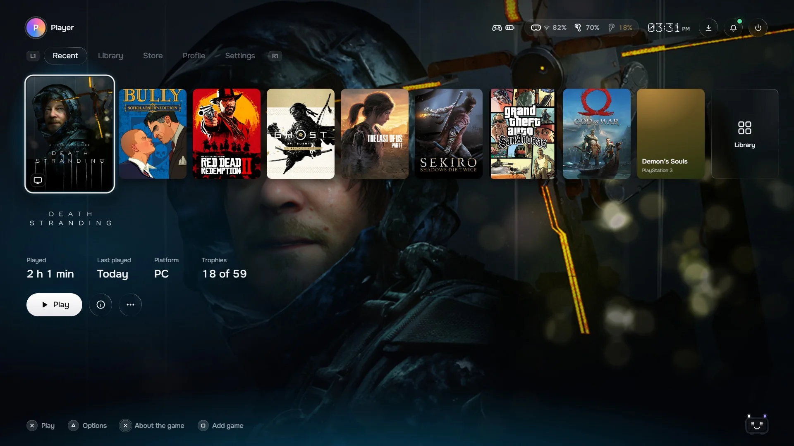

## What it does

<table>
  <tr>
    <td width="46%"></td>
    <td valign="middle">
      <h3>One library</h3>
      <b>Every game on your PC, side by side.</b>  
      PC, Steam, PlayStation&nbsp;2, PlayStation&nbsp;3 and VR games in one launcher. Steam games, disc images and the RPCS3 list import in one go; for anything else, pick a folder and PlayOS finds the EXE. Covers, backgrounds and logos arrive on their own. Search, collections and sorting are a stick flick away.  
      <a href="docs/FAQ.en.md#games">Learn more&nbsp;›</a>
    </td>
  </tr>
  <tr>
    <td valign="middle">
      <h3>Any controller</h3>
      <b>No Big Picture needed.</b>  
      DualSense, DualShock&nbsp;4, Xbox, 8BitDo, Nintendo and older DirectInput pads, with a button mapper for the unusual ones. Button hints follow the pad in your hands; an on-screen keyboard, menu vibration and right-stick scrolling are built in. Mouse and keyboard share one focus with the controller.  
      <a href="docs/FAQ.en.md#controls">Learn more&nbsp;›</a>
    </td>
    <td width="46%"></td>
  </tr>
  <tr>
    <td width="46%"></td>
    <td valign="middle">
      <h3>Its own overlay</h3>
      <b>Press PS. The game waits.</b>  
      The PS or Guide button pauses the game and opens quick saves with screenshots, session time, volume, audio output, brightness and controller battery. PCSX2 saves land in the right slot. Don’t want the overlay in a particular game? Turn it off just there.  
      <a href="docs/FAQ.en.md#controller-and-overlay">Learn more&nbsp;›</a>
    </td>
  </tr>
  <tr>
    <td valign="middle">
      <h3>Cloud saves</h3>
      <b>Your saves. Only in your cloud.</b>  
      Saves of PS2, PS3 and PC games, your library, play time and profile go to your own Yandex Disk, Google Drive or sync folder. PlayOS has no servers of its own. Up to <b>30</b> versions of every save are kept, and when two PCs disagree, you choose.  
      <a href="docs/FAQ.en.md#cloud-saves">Learn more&nbsp;›</a>
    </td>
    <td width="46%"></td>
  </tr>
  <tr>
    <td width="46%"></td>
    <td valign="middle">
      <h3>Store and downloads</h3>
      <b>Find a game. Keep it.</b>  
      A built-in store with the Steam and GOG catalogues: browse by genre, filter by tags, years and reviews, add a game to the library with one button. Connect your own download sources and PlayOS downloads, unpacks and installs the game — with a queue, speed limits and a pause while you play.
    </td>
  </tr>
  <tr>
    <td valign="middle">
      <h3>Profile and trophies</h3>
      <b>Finish a game. Put it on the shelf.</b>  
      Finished games go on your shelf, rated with one of Tivi’s faces. Collect <b>14</b> Tivi figures — for the first game, for the hundredth, for a game beaten in three days or at night. RetroAchievements bring trophies to PS2 classics and Steam achievements cover PC games, with platinum for a full set.  
      <a href="docs/FAQ.en.md#trophies">Learn more&nbsp;›</a>
    </td>
    <td width="46%"></td>
  </tr>
  <tr>
    <td width="46%"></td>
    <td valign="middle">
      <h3>Built-in VR</h3>
      <b>Put it on. Press play.</b>  
      Mark any PC game as a VR game and play it on Meta&nbsp;Quest over Link or Air&nbsp;Link. PlayOS prepares the open-source OpenComposite runtime before every launch, remembers sharpness, hands and vibration for each game, and shows the headset and controller battery in the top bar.
    </td>
  </tr>
  <tr>
    <td valign="middle">
      <h3>Holidays</h3>
      <b>It snows in December.</b>  
      For New Year, Halloween and Valentine’s Day the interface gets decorations made of the same glowing dots — snow and a string of lights, bats and pumpkins, floating hearts — and its own sounds. It follows the calendar, and one setting turns it off.
    </td>
    <td width="46%"></td>
  </tr>
</table>

## Meet Tivi

  

Tivi is the little TV that lives in the corner of PlayOS. He follows what you do, cheers for trophies, naps when you are away and keeps himself busy: lights a fireplace on his screen, plays pong, sneezes, dances. In winter he catches snowflakes, in summer he melts. One switch turns him off — but nobody does.

## Screens

<table>
  <tr>
    <td width="50%">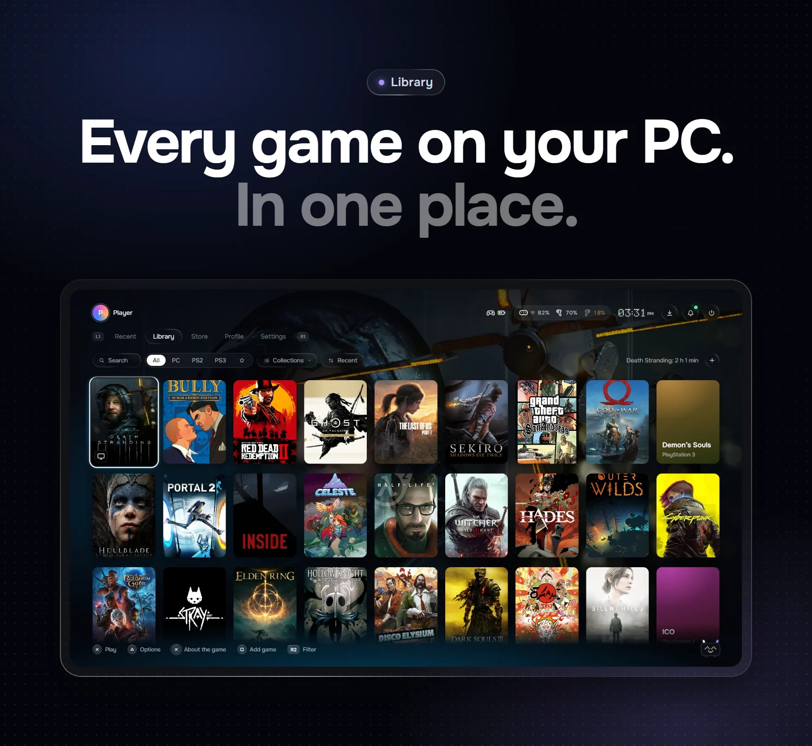 
<b>Library</b>
</td>
    <td width="50%">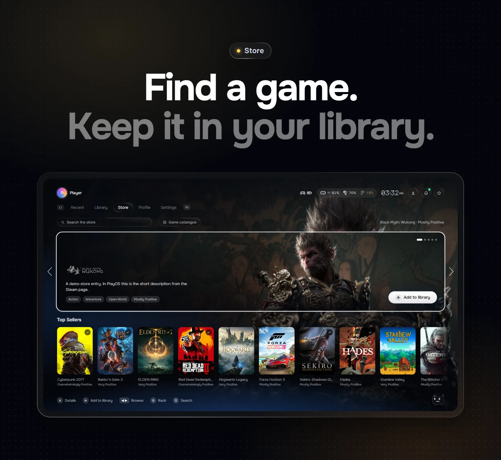 
<b>Store</b>
</td>
  </tr>
  <tr>
    <td width="50%">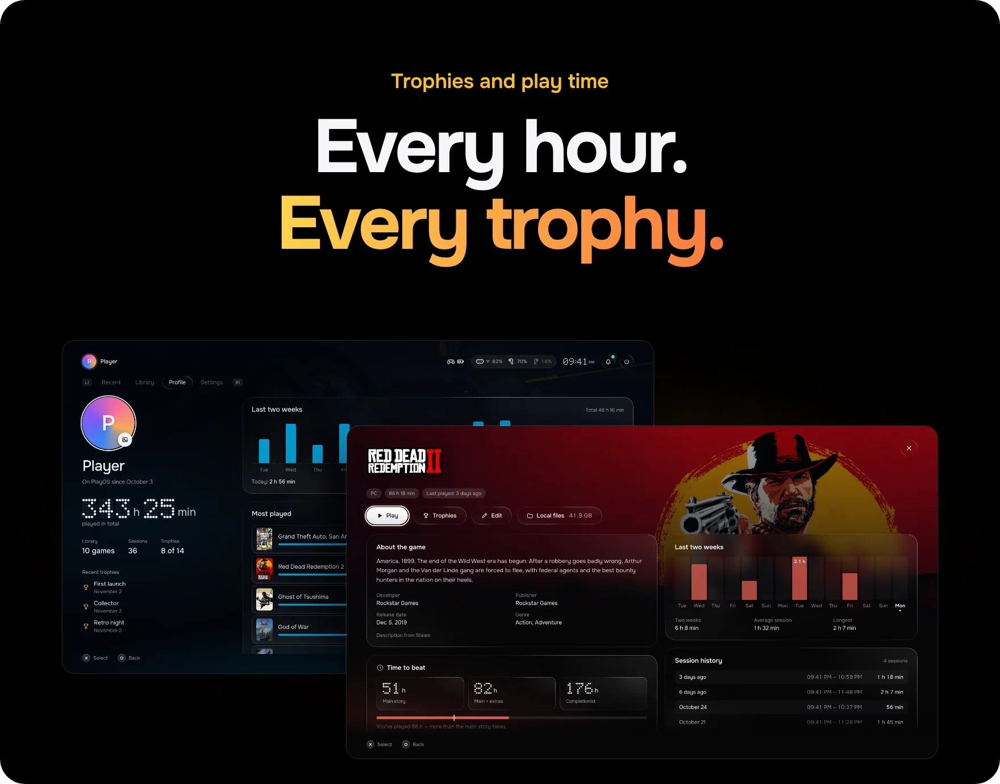 
<b>Profile</b>
</td>
    <td width="50%">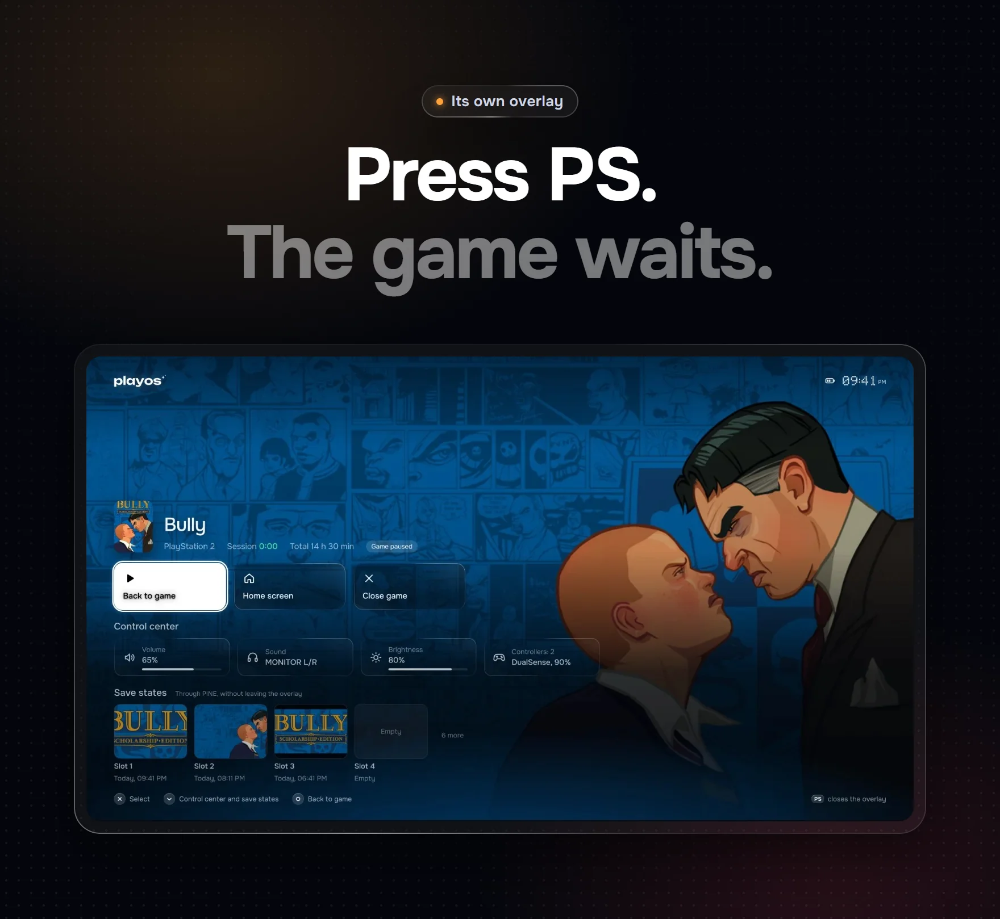 
<b>Overlay</b>
</td>
  </tr>
</table>

## Also

- **Lives on the TV** — pick the display for PlayOS and emulators, scale the interface, dark, light or system theme.
- **Stays out of the way** — unloads its interface while you play, sits in the tray, comes back on the PS button.
- **A living home screen** — backgrounds turn into silent trailers; the menu and the DualSense light bar take the game’s color.
- **Notification center** — errors, trophies and updates wait there; pop-up size and time are yours to set.
- **Updates itself** — new versions arrive in the background with a short list of changes.
- **English and Russian** — the whole interface, and game descriptions from Steam and Wikipedia.

## Get started

1. Download `PlayOS-Setup-<version>.exe` from the [latest release](https://github.com/fakem1nk/PlayOS/releases/latest) and run it. If Windows SmartScreen stops it, click “More info” → “Run anyway” ([why](docs/FAQ.en.md#windows-says-windows-protected-your-pc)).
2. A short first setup asks for your name and language, connects the cloud, finds your games, points to the emulators and picks the display and volume. Any step can be skipped.
3. That’s it: from now on PlayOS updates itself.

| To play | You need |
| --- | --- |
| PC and Steam games | Windows 10 or 11, 64-bit |
| PlayStation&nbsp;2 games | [PCSX2](https://pcsx2.net), your BIOS and disc images |
| PlayStation&nbsp;3 games | [RPCS3](https://rpcs3.net) and the PS3 firmware |
| VR games | Meta&nbsp;Quest and the Meta Horizon Link app |
| With the DualSense light bar | [DSX](https://store.steampowered.com/app/1812620/DSX/) |
| With trophies and art for almost any game | Free RetroAchievements, Steam Web API and SteamGridDB keys (optional) |

Controls, emulator settings and common problems are in the [F.A.Q](docs/FAQ.en.md). Found a bug? Here’s [how to report it](docs/BUG_REPORT.md).

## Contributors

PlayOS is open source and grows from what players ask for. Share an idea in [Discussions](https://github.com/fakem1nk/PlayOS/discussions), report a bug in [Issues](https://github.com/fakem1nk/PlayOS/issues/new/choose), or start with the [developer guide](docs/DEVELOPMENT.md).

## License

PlayOS is licensed under the [GPL-3.0](LICENSE) license.

  

  
  
  
  

PlayOS is an independent project and is not affiliated with Sony Interactive Entertainment, Valve, Microsoft or Meta. PlayStation, DualSense, Steam, Xbox and Meta&nbsp;Quest are trademarks of their respective owners. Screens show PlayOS with its built-in demo library; game art belongs to its rights holders. Emulators, BIOS files and games are not included.
