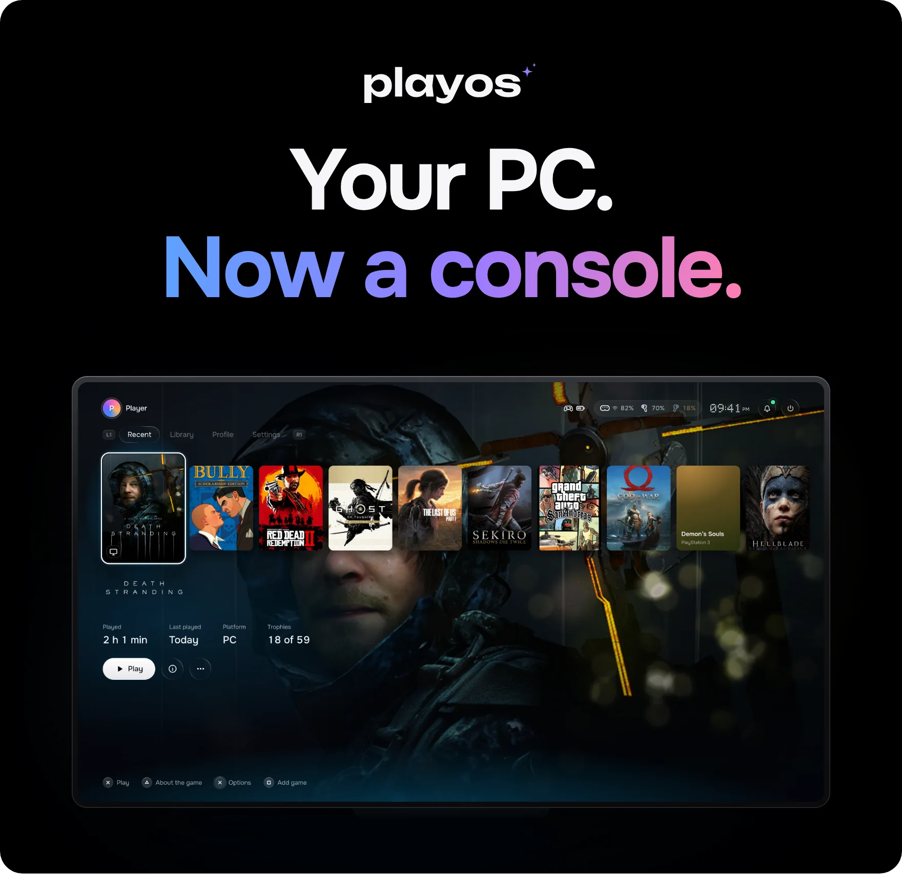
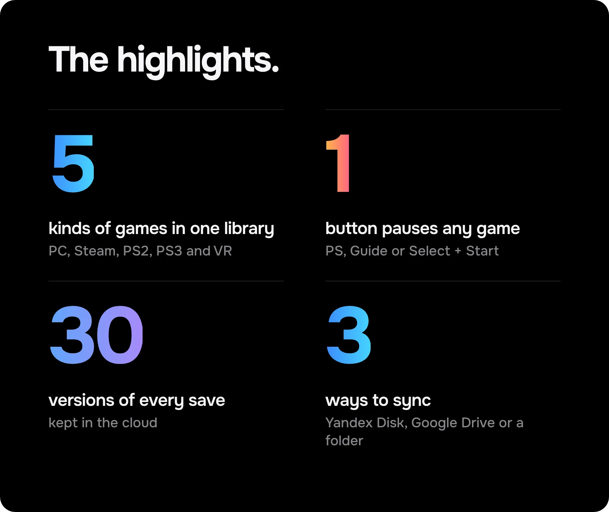
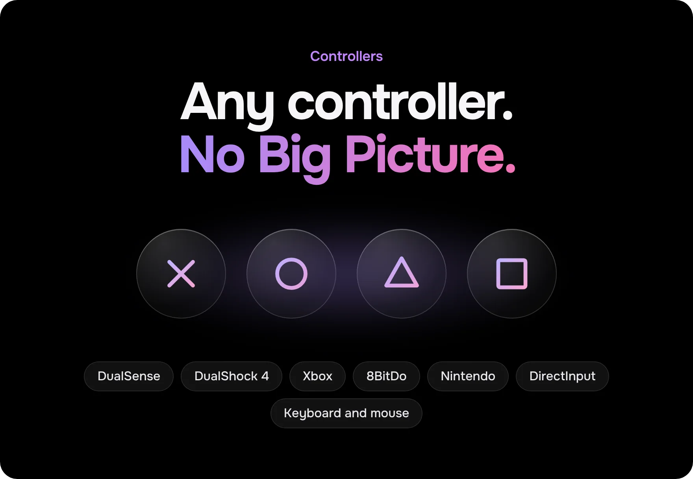
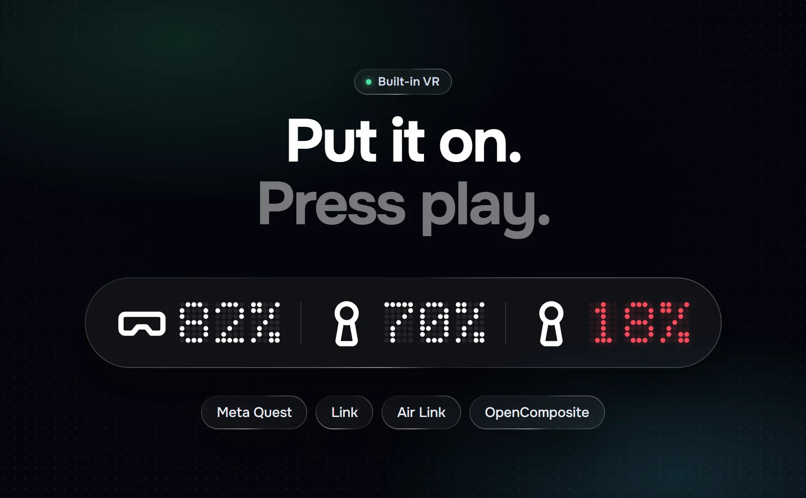
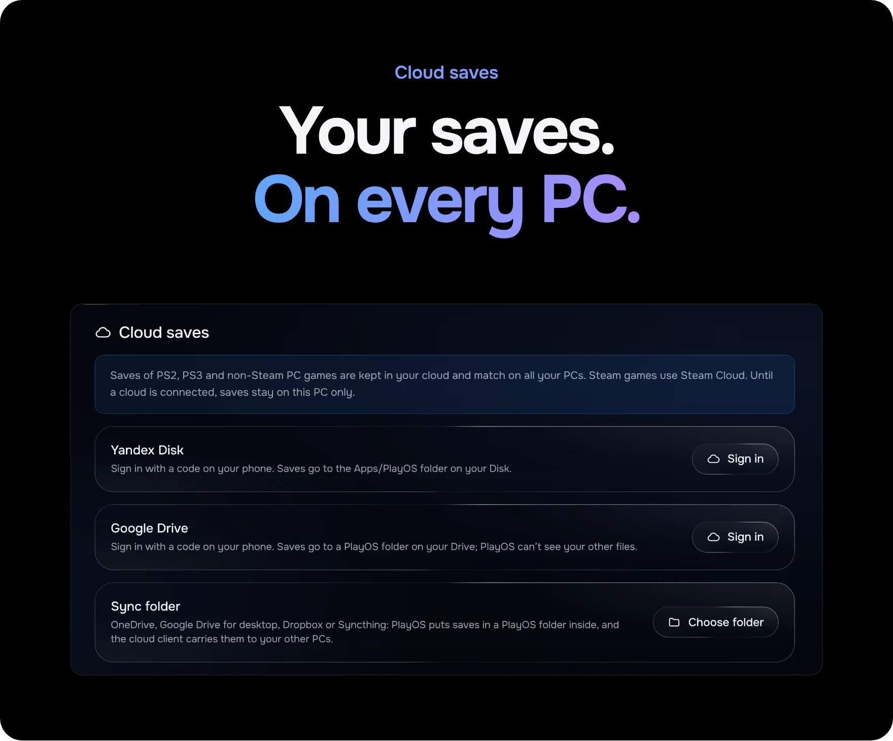
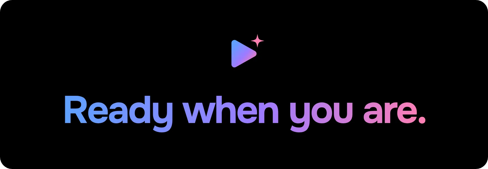

  <b>PlayOS</b>
  &emsp;
  <a href="#overview">Overview</a>
  &nbsp;·&nbsp;
  <a href="#get-started">Get started</a>
  &nbsp;·&nbsp;
  <a href="docs/FAQ.en.md">F.A.Q</a>
  &nbsp;·&nbsp;
  <a href="docs/DEVELOPMENT.md">Developers</a>
  &emsp;
  <b>English</b> | <a href="README.ru.md">Русский</a>

  

  Every game you own — PC, Steam, PlayStation&nbsp;2, PlayStation&nbsp;3 and VR — in one place, 
  driven entirely by a controller. Free and open source, for Windows&nbsp;10 and&nbsp;11.

  <a href="https://github.com/fakem1nk/PlayOS/releases/latest"><b>Download for Windows&nbsp;›</b></a>
  &emsp;&emsp;
  <a href="#overview"><b>Learn more&nbsp;›</b></a>

 

  

 

  

  PC, Steam, PlayStation&nbsp;2, PlayStation&nbsp;3 and VR games side by side. <b>Steam games, disc images and the RPCS3 list import in one go</b>; for anything else, pick a folder and PlayOS finds the EXE. Covers, backgrounds and logos arrive on their own, and <b>search, collections and sorting</b> are a stick flick away. You can even uninstall a game without leaving the couch.

<a href="docs/FAQ.en.md#games">Learn more about games&nbsp;›</a>

 

  

  DualSense, DualShock&nbsp;4, Xbox, 8BitDo, Nintendo and older DirectInput pads, with a button mapper for the unusual ones. <b>Button hints follow the pad in your hands</b> and whatever is selected. An on-screen keyboard, menu vibration and right-stick scrolling are built in, and <b>the mouse and keyboard share one focus</b> with the controller.

<a href="docs/FAQ.en.md#controls">See the controls&nbsp;›</a>

 

  

  The <b>PS or Guide button</b>, Select&nbsp;+&nbsp;Start or Ctrl&nbsp;+&nbsp;Alt&nbsp;+&nbsp;H pauses the game and opens <b>quick saves with screenshots</b>, session time, volume, audio output, brightness and controller battery. PCSX2 saves land in the right slot over PINE. Don't want the menu in a particular game? Turn it off just there.

<a href="docs/FAQ.en.md#controller-and-overlay">Learn more about the overlay&nbsp;›</a>

 

  

  Mark any PC game as a VR game and play it on <b>Meta&nbsp;Quest over Link or Air&nbsp;Link</b>. PlayOS downloads OpenComposite and prepares it before every launch, remembers <b>sharpness, hands, vibration and compatibility mode</b> for each game, and shows the headset and controller battery right in the top bar.

 

  

  Saves, library, play time and profile on <b>Yandex Disk, Google Drive or a sync folder</b>. PC saves are found through the Ludusavi database, <b>up to 30 versions</b> of each are kept, and when two PCs disagree, you choose. On a new PC everything comes back — or move it all with a single <code>.playos</code> backup file.

<a href="docs/FAQ.en.md#cloud-saves">Learn more about cloud saves&nbsp;›</a>

 

  

  Every session counts, even through third-party launchers. The game page shows <b>HowLongToBeat</b>, session history and two weeks of activity. <b>RetroAchievements for PS2 and Steam achievements for PC</b> — including games on Steam emulators — pop up the moment they unlock, and the trophy list keeps a screenshot of that moment.

<a href="docs/FAQ.en.md#trophies">Learn more about trophies&nbsp;›</a>

 

<h3 align="center">And so much more.</h3>

<table>
  <tr>
    <td width="50%" valign="top">
       
      <b>A living home screen</b> 
      Backgrounds turn into silent trailers, and the menu and the DualSense light bar take the color of the game.
    </td>
    <td width="50%" valign="top">
       
      <b>Ready for the TV</b> 
      Choose the display for PlayOS and emulators, scale the interface, pick a dark, light or system theme. Starts with Windows and plays well with Moonlight.
    </td>
  </tr>
  <tr>
    <td width="50%" valign="top">
       
      <b>Notification Center</b> 
      Errors, trophies and updates wait for you there. Set the pop-up size and time on screen, or turn pop-ups off.
    </td>
    <td width="50%" valign="top">
       
      <b>Stays out of the way</b> 
      While you play, PlayOS unloads its interface and runs in Windows efficiency mode. Closing the window keeps it in the tray, and the PS button brings it back.
    </td>
  </tr>
  <tr>
    <td width="50%" valign="top">
       
      <b>Updates itself</b> 
      New versions download in the background with a short list of changes in your language. Beta versions are opt-in, and you can always go back to stable.
    </td>
    <td width="50%" valign="top">
       
      <b>English and Russian</b> 
      The whole interface, and game descriptions from Steam and Wikipedia, in your language.
    </td>
  </tr>
</table>

 

  

  <a href="https://github.com/fakem1nk/PlayOS/releases/latest"><b>Download for Windows&nbsp;›</b></a>

 

## Get started

1. Download `PlayOS-Setup-<version>.exe` from the [latest release](https://github.com/fakem1nk/PlayOS/releases/latest) and run it. If Windows SmartScreen stops it, click “More info” → “Run anyway” ([why](docs/FAQ.en.md#windows-says-windows-protected-your-pc)).
2. A short first setup asks for your name and language, connects the cloud, finds your games, points to the emulators and picks the display and volume. Any step can be skipped and changed later in Settings.
3. That's it: from now on PlayOS updates itself.

| To play | You need |
| --- | --- |
| PC and Steam games | Windows 10 or 11, 64-bit |
| PlayStation&nbsp;2 games | [PCSX2](https://pcsx2.net), your BIOS and disc images |
| PlayStation&nbsp;3 games | [RPCS3](https://rpcs3.net) and the PS3 firmware |
| VR games | Meta&nbsp;Quest and the Meta Horizon Link app |
| With the DualSense light bar | [DSX](https://store.steampowered.com/app/1812620/DSX/) |
| With trophies and art for almost any game | Free RetroAchievements, Steam Web API and SteamGridDB keys (optional) |

Controls, emulator settings and common problems are in the [F.A.Q](docs/FAQ.en.md). Found a bug? Here's [how to report it](docs/BUG_REPORT.md).

## Contributors

Want to help? Start with the [developer guide](docs/DEVELOPMENT.md). Ideas and bug reports are welcome in [Issues](https://github.com/fakem1nk/PlayOS/issues/new/choose).

## License

PlayOS is licensed under the [GPL-3.0](LICENSE) license.

 

  
  
  
  

PlayOS is an independent project and is not affiliated with Sony Interactive Entertainment, Valve, Microsoft or Meta. PlayStation, DualSense, Steam, Xbox and Meta&nbsp;Quest are trademarks of their respective owners. Screens show PlayOS with its built-in demo library; game art belongs to its rights holders. Emulators, BIOS files and games are not included.
