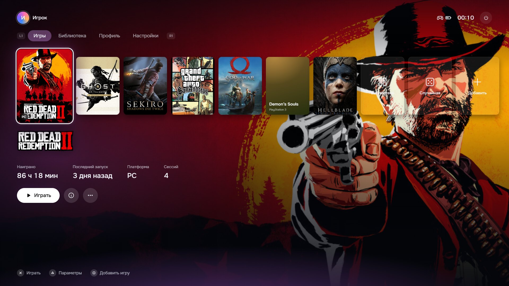
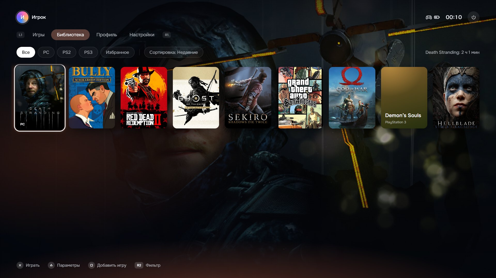
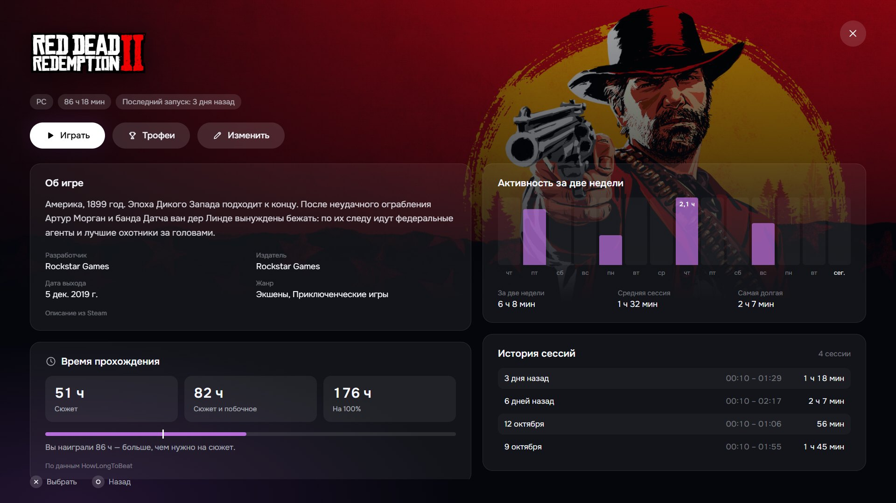
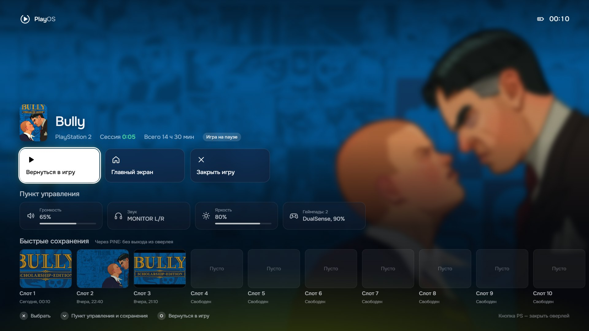
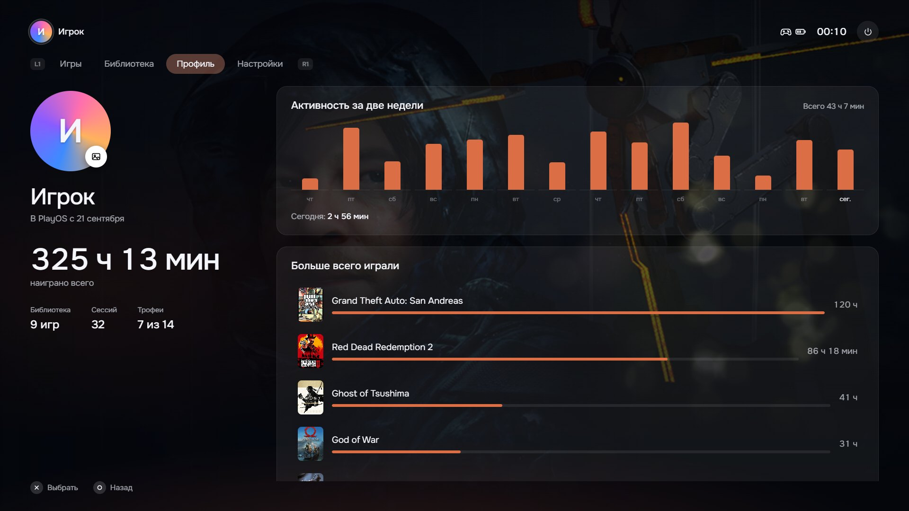
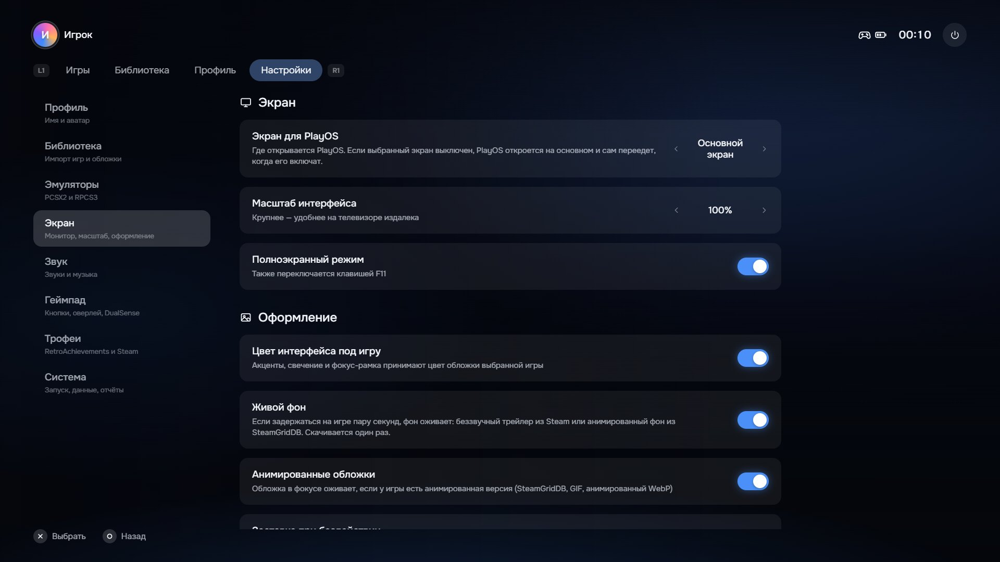
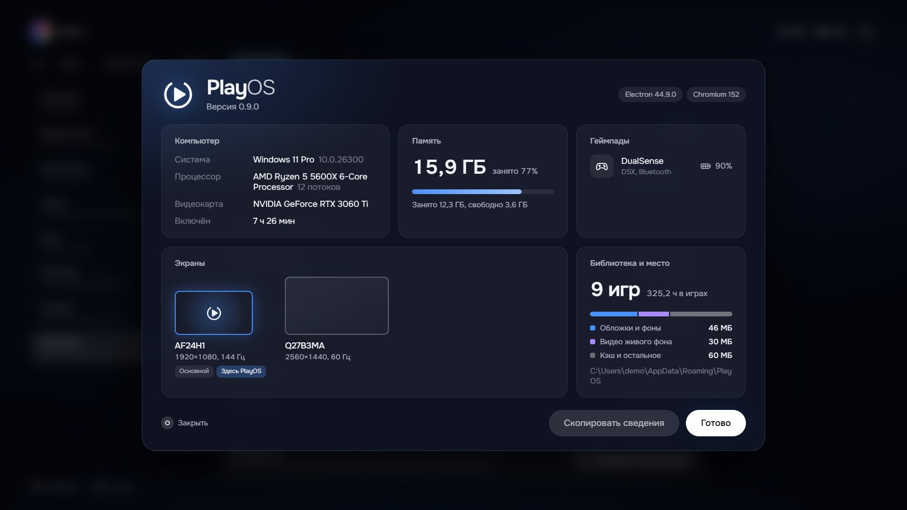

<p align="center">
  
</p>

<h1 align="center">PlayOS</h1>

<p align="center"><b>Ваш компьютер — как приставка.</b></p>

<p align="center">
  Игры с PC, PlayStation 2 и PlayStation 3 в одной библиотеке.<br>
  Выбираете обложку геймпадом — и играете. На мониторе, телевизоре или через Moonlight.
</p>

<p align="center"><a href="README.en.md">English</a> · <b>Русский</b></p>

<p align="center">
  <a href="https://github.com/fakem1nk/PlayOS/releases/latest"><b>Скачать для Windows</b></a>
  &nbsp;·&nbsp;
  <a href="#возможности">Возможности</a>
  &nbsp;·&nbsp;
  <a href="docs/FAQ.md">Вопросы и проблемы</a>
  &nbsp;·&nbsp;
  <a href="#нашли-ошибку">Нашли ошибку</a>
  &nbsp;·&nbsp;
  <a href="#для-разработчиков">Для разработчиков</a>
</p>

<br>

## Зачем

Игры на компьютере живут в разных местах: Steam, эмуляторы, папки с образами. Чтобы просто поиграть с дивана, приходится вставать к мыши.

PlayOS собирает всё в одну библиотеку и даёт ей интерфейс приставки. Включили, выбрали обложку, играете. Время, трофеи и сохранения — на месте. Мышь не нужна.

<br>

## Главный экран

Последние игры одним рядом. Фон, цвет меню и подсветка геймпада меняются под обложку в фокусе, а если задержаться, фон оживает трейлером.



<br>

## Вся библиотека

Игры Steam находятся сами, образы PS2 узнаются по серийному номеру диска, игры PS3 подтягиваются из RPCS3. Фильтры по платформе и избранному, сортировка по времени в игре.



<br>

## Страница игры

Описание, время прохождения с HowLongToBeat и сколько из него вы уже наиграли, активность за две недели и история каждой сессии.



<br>

## Поверх любой игры

Кнопка PS открывает меню прямо в игре. Игра встаёт на паузу, а рядом — быстрые сохранения эмулятора со скриншотами, громкость, звуковой выход, яркость и заряд геймпада.



<br>

## Профиль и трофеи

Сколько наиграно и во что больше всего. Настоящие трофеи — RetroAchievements для PS2 и достижения Steam для PC — с уведомлениями прямо поверх игры.



<br>

## Настройки

Всё проходится крестовиной: экран и масштаб для телевизора, звук, геймпад, эмуляторы. Сведения о системе — в одном окне.

<table>
  <tr>
    <td width="50%"></td>
    <td width="50%"></td>
  </tr>
</table>

<br>

## Возможности

**Библиотека**
- PC (EXE и игры Steam), PlayStation 2 через PCSX2, PlayStation 3 через RPCS3
- Обложки, фоны и логотипы из Steam, SteamGridDB и Википедии, анимированные обложки
- Учёт времени по сессиям, даже если игра запускается через свой лаунчер

**Во время игры**
- Меню поверх игры по кнопке PS, Guide или Ctrl + Alt + H, с паузой игры
- Быстрые сохранения PCSX2 в нужный слот без переключения окон
- Трофеи, напоминание о перерыве, предупреждение о разряде геймпада

**Геймпады**
- DualSense и DualShock 4, Xbox, 8BitDo и Nintendo — значки кнопок подстраиваются сами
- Старые USB-геймпады в режиме DirectInput: кнопки назначаются в настройках за минуту
- Всё работает и с одной клавиатурой, подсказки тогда показывают клавиши
- DualSense через DSX: световая панель в цвет игры, вспышка при трофее, красная пульсация при разряде

**Интерфейс**
- Интро и аутро, заставка при бездействии, экранная клавиатура
- Выбор экрана и масштаб интерфейса для телевизора
- Русский и английский язык
- Звуки синтезируются на лету — в проекте нет ни одного звукового файла

<br>

## Управление

| | PlayStation | Xbox | Nintendo, 8BitDo | Клавиатура |
| --- | :---: | :---: | :---: | :---: |
| Играть, выбрать | ✕ | A | B | Enter |
| Назад | ○ | B | A | Esc |
| Параметры игры | △ | Y | X | M |
| Добавить игру | ▢ | X | Y | F |
| Вкладки | L1 / R1 | LB / RB | L / R | Q / E |
| Фильтры библиотеки | L2 / R2 | LT / RT | ZL / ZR | Z / C |
| Меню в игре | PS | Guide | — | Ctrl + Alt + H |

Кнопки перепутаны? Настройки → Геймпад → «Настроить кнопки геймпада».

<br>

## Установка

1. Скачайте `PlayOS-Setup.exe` со страницы [релизов](https://github.com/fakem1nk/PlayOS/releases/latest).
2. Установите в любую папку.
3. При первом запуске короткий мастер поможет добавить игры и настроить экран.

Дальше PlayOS обновляется сам: новая версия скачивается в фоне и ставится при выходе.

**Нужно:** Windows 10 или 11, 64 бит. Для игр PS2 и PS3 — установленные PCSX2 и RPCS3, для подсветки DualSense — DSX. Всё остальное необязательно.

Библиотека и настройки хранятся в `%APPDATA%\PlayOS` и переживают переустановку.

**Переезд на другой компьютер.** Настройки → Система → «Сохранить копию данных». На рабочем столе появится один файл `.playos`: библиотека, время в играх, трофеи, настройки с ключами API, аватар и обложки. На новом компьютере — «Восстановить из копии», и PlayOS перезапустится со всем этим. Ключи API лежат в файле открыто, поэтому не выкладывайте его в сеть.

<br>

## Нашли ошибку

Сначала загляните в [вопросы и проблемы](docs/FAQ.md): там разобраны частые случаи — игра не запускается, PCSX2 не найден, нет подсветки, предупреждение SmartScreen.

Если не помогло, лучше всего — [задача на GitHub](https://github.com/fakem1nk/PlayOS/issues/new/choose). Чтобы мы смогли быстро повторить и исправить проблему:

1. **Обновитесь.** Проверьте, что стоит последняя версия: Настройки → Система → «Обновления». Возможно, ошибку уже исправили.
2. **Поищите похожую задачу** среди [открытых](https://github.com/fakem1nk/PlayOS/issues). Если она есть — добавьте туда свой случай, а не создавайте новую.
3. **Сохраните отчёт.** Настройки → Система → «Сохранить отчёт об ошибках». На рабочем столе появится файл `PlayOS-отчёт-….txt` с журналом и сведениями о системе. Ключей API в нём нет. Приложите его к задаче.
4. **Опишите по шагам**, что вы делали, что ожидали и что произошло на самом деле. Одна проблема — одна задача.
5. **Добавьте подробности,** если они касаются проблемы: игра и платформа (PC, PS2, PS3), версия эмулятора, какой геймпад и как подключён, скриншот или короткое видео.

Если PlayOS не запускается совсем, журнал лежит в `%APPDATA%\PlayOS\logs\playos.log` — приложите его вместо отчёта.

Идеи и пожелания тоже приветствуются — для них есть отдельный шаблон. Пожалуйста, общайтесь уважительно: правила — в [кодексе поведения](CODE_OF_CONDUCT.md).

<br>

## Для разработчиков

Electron, React и TypeScript. Работа с системой — в main-процессе: WinAPI через koffi, DualSense по HID, небольшой помощник на C# для звука и яркости.

```bash
npm install
npm run dev
```

| Команда | Что делает |
| --- | --- |
| `npm run dev` | Запуск с горячей перезагрузкой |
| `npm run web` | Интерфейс в браузере на демо-данных |
| `npm run typecheck` | Проверка типов |
| `npm run dist:setup` | Установщик в `release/` |
| `npm run release` | Установщик и черновик релиза с этого компьютера (нужен `GH_TOKEN`) |

**Выпуск версии.** Поднимите `version` в `package.json`, добавьте заметки в `scripts/notes/<версия>.md`, затем отправьте тег:

```bash
git tag v0.9.3 && git push origin v0.9.3
```

GitHub Actions соберёт установщик и положит его в черновик релиза. Останется проверить текст и нажать «Publish». Версии до 1.0.0 помечаются как pre-release и приходят только участникам бета-теста.

<details>
<summary><b>Карта проекта</b></summary>

```
src/
├── main/                 Процесс Electron: всё, что работает с системой
│   ├── index.ts          Окна, оверлей, IPC, питание, выбор экрана
│   ├── launcher.ts       Запуск игр и учёт времени по процессам
│   ├── store.ts          Библиотека и настройки (library.json)
│   ├── media.ts          Поиск и загрузка арта
│   ├── details.ts        Описания, HowLongToBeat, трейлеры для живого фона
│   ├── steam.ts          Поиск установленных игр Steam
│   ├── achievements.ts   RetroAchievements и достижения Steam
│   ├── pcsx2.ts, pine.ts Быстрые сохранения PCSX2
│   ├── gamepad.ts, hid.ts, win32.ts   Кнопка PS, XInput, DualSense по HID
│   ├── dsx.ts            Подсветка DualSense через DSX
│   ├── system.ts         Громкость, звуковые выходы, яркость
│   ├── updater.ts        Обновления из релизов GitHub
│   ├── backup.ts         Копия данных для переноса на другой ПК
│   └── log.ts            Журнал и отчёт об ошибках
├── preload/              Мост между интерфейсом и системой
├── renderer/src/         Интерфейс на React
│   ├── App.tsx           Главный экран, вкладки, окна поверх
│   ├── OverlayApp.tsx    Меню поверх игры
│   ├── components/       Экраны: библиотека, профиль, настройки, интро, мастер…
│   └── lib/              Ввод с геймпада, навигация, звуки, состояние
└── shared/               Общие типы и перевод (i18n.ts, i18n-en.ts)
native/SystemHelper.cs    Помощник Windows для звука и яркости
scripts/                  Установка и выпуск релизов
docs/screenshots/         Скриншоты для этого файла
```

</details>

<br>

## Лицензия

[GPL-3.0](LICENSE).

PlayOS — независимый проект и не связан с Sony Interactive Entertainment, Valve или Microsoft. PlayStation, DualSense, Steam и Xbox — товарные знаки их владельцев. Обложки на скриншотах принадлежат правообладателям игр. Эмуляторы и образы игр в комплект не входят.
