

  <a href="https://github.com/fakem1nk/PlayOS/releases/latest"></a>

<h1 align="center">Ваш ПК. Теперь приставка.</h1>

  Главный экран приставки для Windows с полным управлением геймпадом. Игры PC, Steam, PlayStation&nbsp;2, PlayStation&nbsp;3 и VR в одном месте. Бесплатно и с открытым кодом.

  <a href="https://github.com/fakem1nk/PlayOS/releases/latest"><b>Скачать для Windows&nbsp;›</b></a>

  <a href="#что-умеет">Что умеет</a>
  &nbsp;·&nbsp;
  <a href="#экраны">Экраны</a>
  &nbsp;·&nbsp;
  <a href="#с-чего-начать">С чего начать</a>
  &nbsp;·&nbsp;
  <a href="docs/FAQ.md">F.A.Q</a>
  &nbsp;·&nbsp;
  <a href="docs/DEVELOPMENT.ru.md">Разработчикам</a>
  &emsp;|&emsp;
  <a href="README.md">English</a> · <b>Русский</b>

  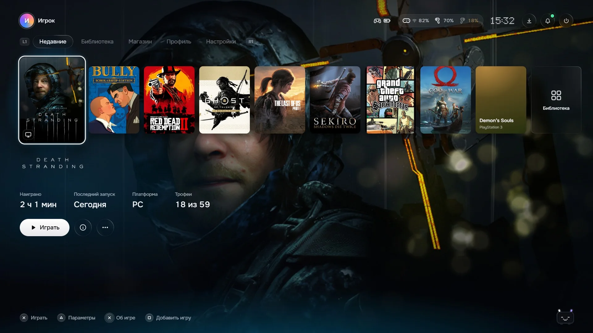

## Что умеет

<table>
  <tr>
    <td width="46%"></td>
    <td valign="middle">
      <h3>Одна библиотека</h3>
      <b>Все игры вашего ПК — рядом.</b>  
      Игры PC, Steam, PlayStation&nbsp;2, PlayStation&nbsp;3 и VR в одном лаунчере. Игры Steam, образы дисков и список RPCS3 добавляются разом; для остального выберите папку — PlayOS сам найдёт EXE. Обложки, фоны и логотипы подтянутся сами. Поиск, подборки и сортировка — одним движением стика.  
      <a href="docs/FAQ.md#игры">Подробнее&nbsp;›</a>
    </td>
  </tr>
  <tr>
    <td valign="middle">
      <h3>Любой геймпад</h3>
      <b>Big Picture не нужен.</b>  
      DualSense, DualShock&nbsp;4, Xbox, 8BitDo, Nintendo и старые DirectInput-геймпады, а для необычных — назначение кнопок. Подсказки показывают кнопки того геймпада, что у вас в руках; экранная клавиатура, вибрация в меню и прокрутка правым стиком встроены. Мышь и клавиатура делят один фокус с геймпадом.  
      <a href="docs/FAQ.md#управление">Подробнее&nbsp;›</a>
    </td>
    <td width="46%"></td>
  </tr>
  <tr>
    <td width="46%"></td>
    <td valign="middle">
      <h3>Свой оверлей</h3>
      <b>Нажмите PS. Игра подождёт.</b>  
      Кнопка PS или Guide ставит игру на паузу и открывает быстрые сохранения со скриншотами, время сессии, громкость, выбор звукового выхода, яркость и заряд геймпада. Сохранения PCSX2 попадают в нужный слот. Не нужен оверлей в какой-то игре? Выключите его только там.  
      <a href="docs/FAQ.md#геймпад-и-оверлей">Подробнее&nbsp;›</a>
    </td>
  </tr>
  <tr>
    <td valign="middle">
      <h3>Облачные сохранения</h3>
      <b>Ваши сохранения. Только в вашем облаке.</b>  
      Сохранения игр PS2, PS3 и PC, библиотека, время в играх и профиль уходят на ваш Яндекс Диск, Google Диск или в папку синхронизации. Своих серверов у PlayOS нет. Хранится до <b>30</b> версий каждого сохранения, а если два ПК расходятся — выбираете вы.  
      <a href="docs/FAQ.md#облачные-сохранения">Подробнее&nbsp;›</a>
    </td>
    <td width="46%"></td>
  </tr>
  <tr>
    <td width="46%"></td>
    <td valign="middle">
      <h3>Магазин и загрузки</h3>
      <b>Найдите игру. Оставьте себе.</b>  
      Встроенный магазин с каталогами Steam и GOG: листайте по жанрам, фильтруйте по тегам, годам и отзывам, добавляйте игру в библиотеку одной кнопкой. Подключите свои источники загрузок — и PlayOS сам скачает, распакует и установит игру: с очередью, ограничением скорости и паузой на время игры.
    </td>
  </tr>
  <tr>
    <td valign="middle">
      <h3>Профиль и трофеи</h3>
      <b>Пройдите игру. Поставьте на полку.</b>  
      Пройденные игры встают на полку с оценкой — одним из лиц Тиви. Соберите <b>14</b> фигурок Тиви: за первую игру, за сотую, за игру, пройденную за три дня или ночью. RetroAchievements дают трофеи классике PS2, достижения Steam — играм PC, а за полный набор полагается платина.  
      <a href="docs/FAQ.md#трофеи">Подробнее&nbsp;›</a>
    </td>
    <td width="46%"></td>
  </tr>
  <tr>
    <td width="46%"></td>
    <td valign="middle">
      <h3>Встроенный VR</h3>
      <b>Наденьте. Нажмите «Играть».</b>  
      Отметьте любую игру PC как VR-игру и играйте на Meta&nbsp;Quest через Link или Air&nbsp;Link. PlayOS сам готовит открытый компонент OpenComposite перед каждым запуском, помнит чёткость, руки и вибрацию для каждой игры и показывает заряд шлема и контроллеров в верхней панели.
    </td>
  </tr>
  <tr>
    <td valign="middle">
      <h3>Праздники</h3>
      <b>В декабре идёт снег.</b>  
      К Новому году, Хэллоуину и 14 февраля интерфейс получает украшения из тех же светящихся точек — снег и гирлянду, летучих мышей и тыквы, сердечки — и свои звуки. Включается по календарю, выключается одной настройкой.
    </td>
    <td width="46%"></td>
  </tr>
</table>

## Знакомьтесь, Тиви

  

Тиви — маленький телевизор, который живёт в углу PlayOS. Он следит за тем, что вы делаете, радуется трофеям, дремлет, когда вас нет, и сам находит себе занятие: включает на экране камин, играет в понг, чихает, танцует. Зимой ловит снежинки, летом тает от жары. Выключается одним переключателем — но никто не выключает.

## Экраны

<table>
  <tr>
    <td width="50%"> 
<b>Библиотека</b>
</td>
    <td width="50%">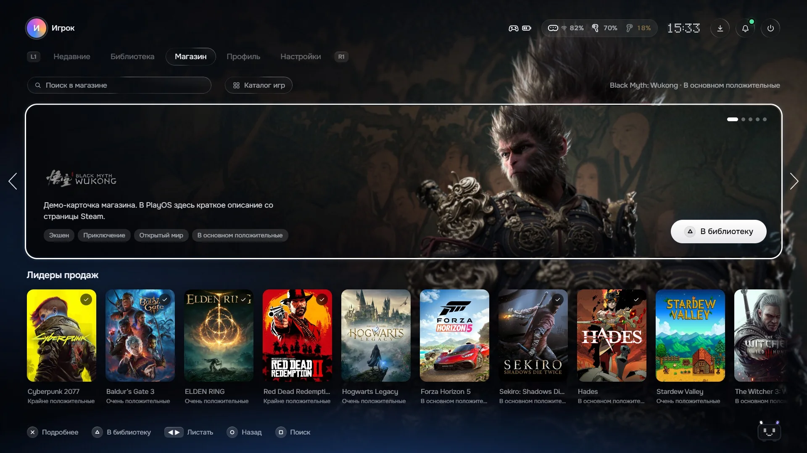 
<b>Магазин</b>
</td>
  </tr>
  <tr>
    <td width="50%"> 
<b>Профиль</b>
</td>
    <td width="50%"> 
<b>Оверлей</b>
</td>
  </tr>
</table>

## Ещё

- **Живёт на телевизоре** — выбор экрана для PlayOS и эмуляторов, масштаб интерфейса, тёмная, светлая или системная тема.
- **Не мешает играть** — выгружает интерфейс на время игры, сидит в трее, возвращается по кнопке PS.
- **Живой главный экран** — фоны превращаются в беззвучные трейлеры, меню и подсветка DualSense принимают цвет игры.
- **Центр уведомлений** — ошибки, трофеи и обновления ждут там; размер и время всплывающих окон настраиваются.
- **Обновляется сам** — новые версии приходят в фоне с коротким списком изменений.
- **Русский и английский** — весь интерфейс и описания игр из Steam и Википедии.

## С чего начать

1. Скачайте `PlayOS-Setup-<версия>.exe` из [последнего релиза](https://github.com/fakem1nk/PlayOS/releases/latest) и запустите. Если SmartScreen остановит установку, нажмите «Подробнее» → «Выполнить в любом случае» ([почему так](docs/FAQ.md#windows-пишет-система-windows-защитила-ваш-компьютер)).
2. Короткая первая настройка спросит имя и язык, подключит облако, найдёт игры, подскажет путь к эмуляторам и поможет выбрать экран и громкость. Любой шаг можно пропустить.
3. Готово: дальше PlayOS обновляется сам.

| Чтобы играть | Что нужно |
| --- | --- |
| В игры PC и Steam | Windows 10 или 11, 64-бит |
| В игры PlayStation&nbsp;2 | [PCSX2](https://pcsx2.net), свой BIOS и образы дисков |
| В игры PlayStation&nbsp;3 | [RPCS3](https://rpcs3.net) и прошивка PS3 |
| В VR-игры | Meta&nbsp;Quest и приложение Meta Horizon Link |
| С подсветкой DualSense | [DSX](https://store.steampowered.com/app/1812620/DSX/) |
| С трофеями и обложками почти для всех игр | Бесплатные ключи RetroAchievements, Steam Web API и SteamGridDB (необязательно) |

Управление, настройка эмуляторов и частые проблемы — в [F.A.Q](docs/FAQ.md). Нашли ошибку? Вот [как о ней сообщить](docs/BUG_REPORT.ru.md).

## Участники

PlayOS — проект с открытым кодом и растёт из того, о чём просят игроки. Предложите идею в [Discussions](https://github.com/fakem1nk/PlayOS/discussions), сообщите об ошибке в [Issues](https://github.com/fakem1nk/PlayOS/issues/new/choose) или начните с [руководства для разработчиков](docs/DEVELOPMENT.ru.md).

## Лицензия

PlayOS распространяется по лицензии [GPL-3.0](LICENSE).

  

  
  
  
  

PlayOS — независимый проект, не связанный с Sony Interactive Entertainment, Valve, Microsoft и Meta. PlayStation, DualSense, Steam, Xbox и Meta&nbsp;Quest — товарные знаки их владельцев. На экранах — PlayOS со встроенной демо-библиотекой; арт игр принадлежит правообладателям. Эмуляторы, BIOS и игры в комплект не входят.
