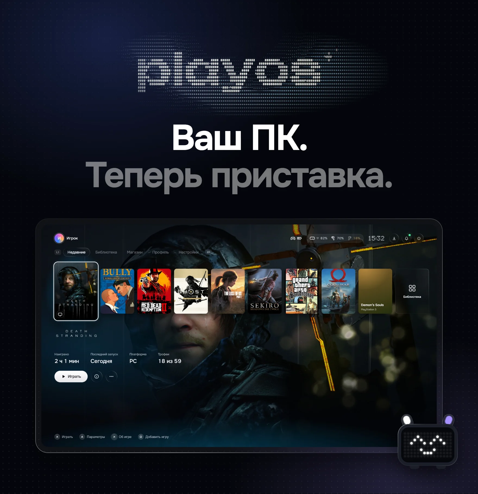
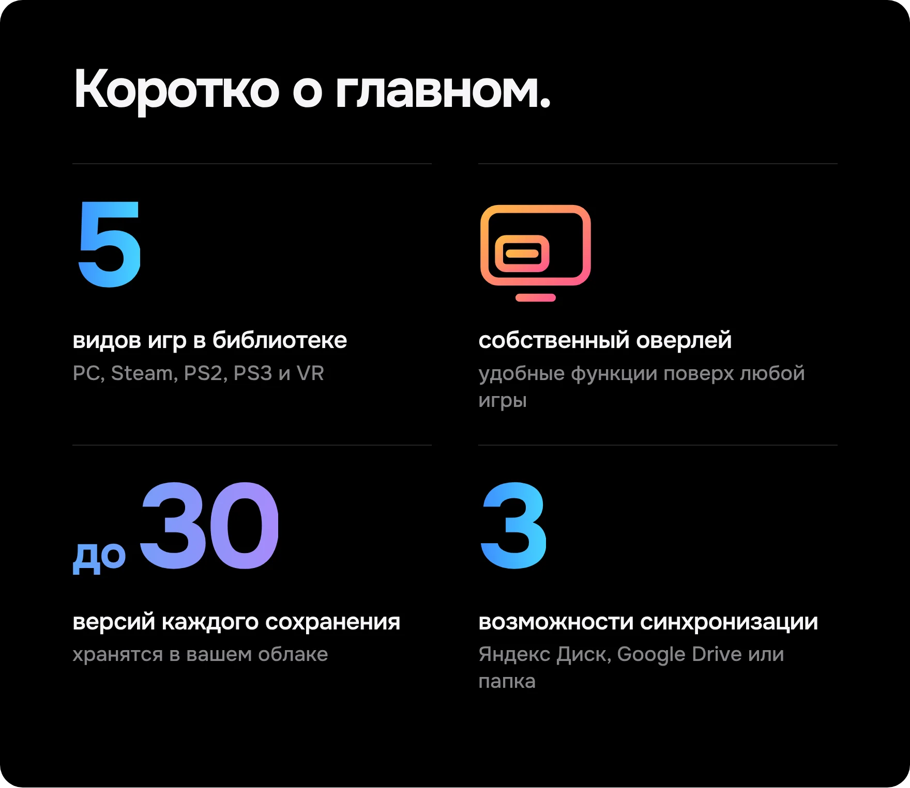
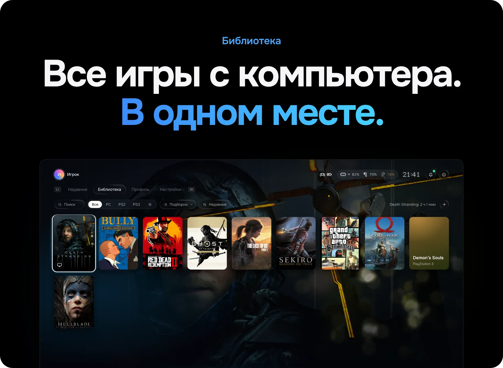
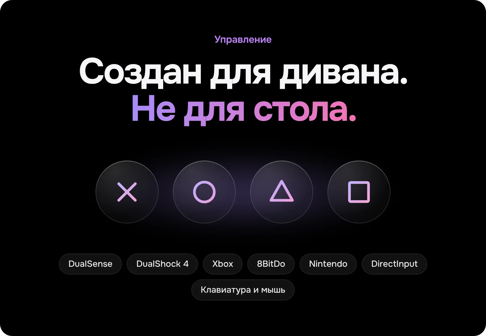
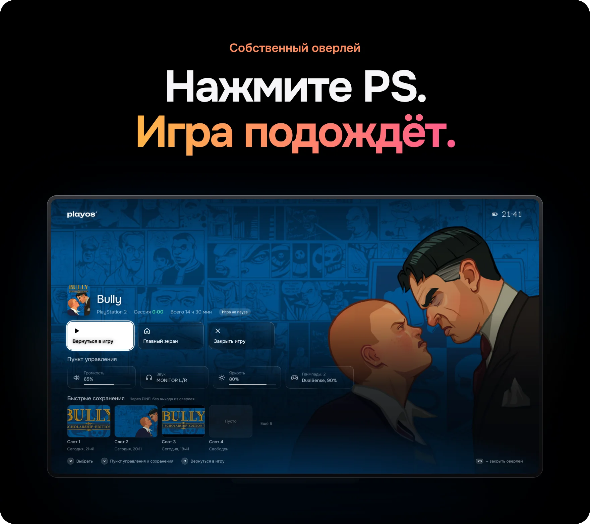
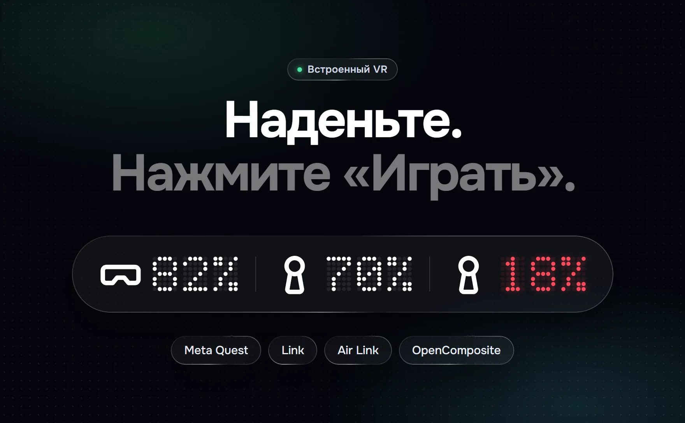
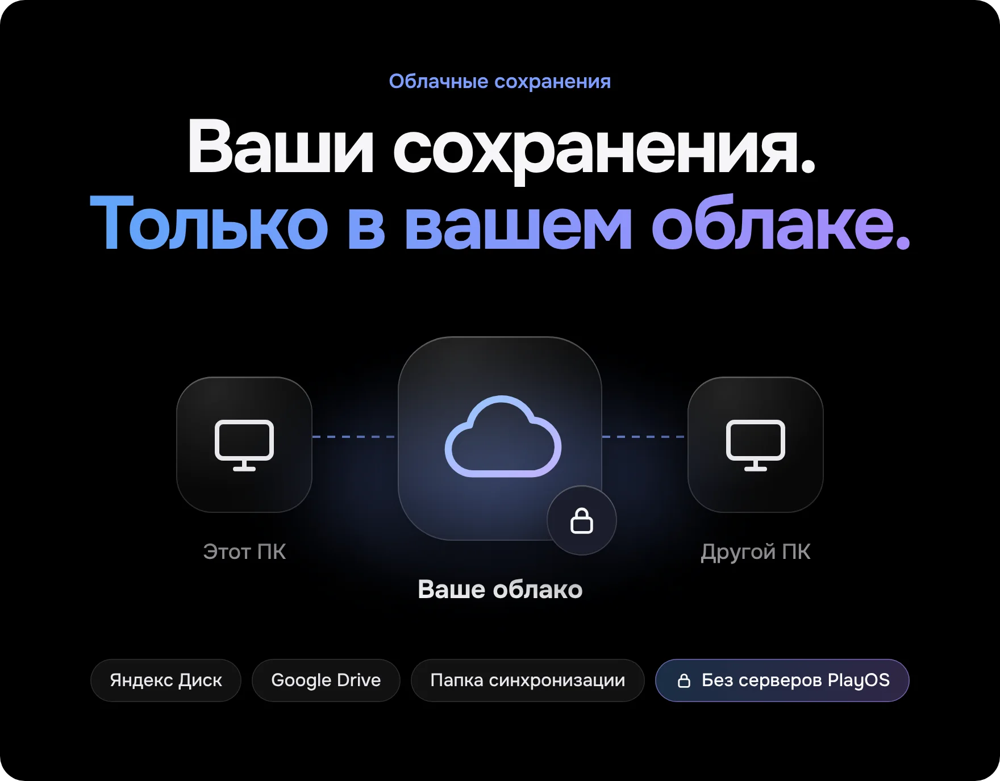
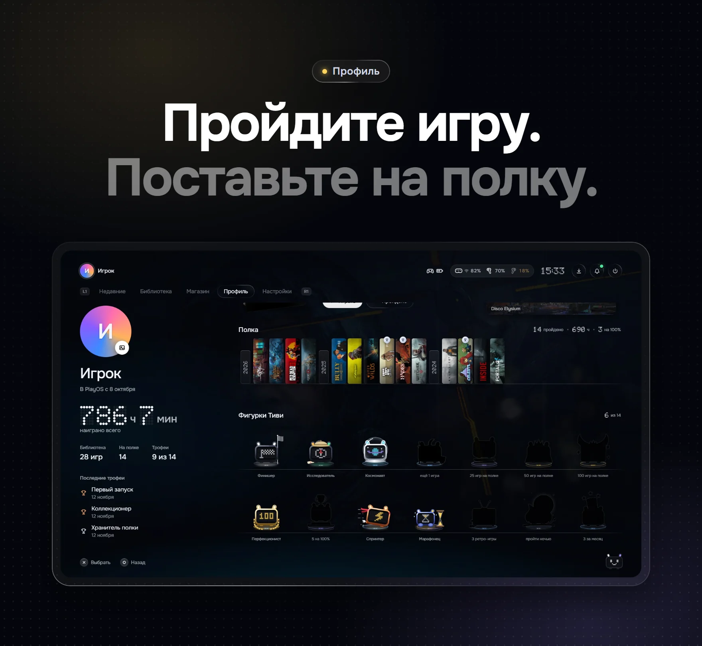
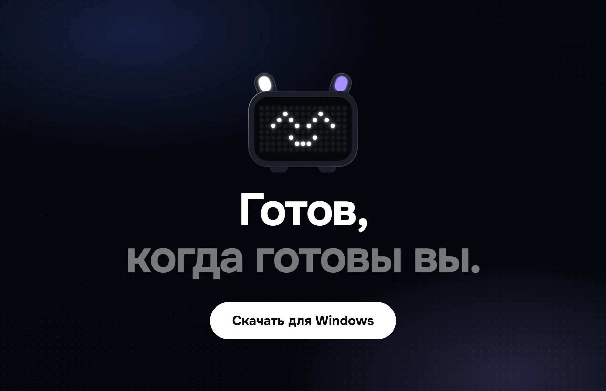

  <b>PlayOS</b>
  &emsp;
  <a href="#обзор">Обзор</a>
  &nbsp;·&nbsp;
  <a href="#с-чего-начать">С чего начать</a>
  &nbsp;·&nbsp;
  <a href="docs/FAQ.md">F.A.Q</a>
  &nbsp;·&nbsp;
  <a href="docs/DEVELOPMENT.ru.md">Разработчикам</a>
  &emsp;
  <a href="README.md">English</a> | <b>Русский</b>

  

  Все ваши игры — PC, Steam, PlayStation&nbsp;2, PlayStation&nbsp;3 и VR — в одном месте 
  и с полным управлением геймпадом. Бесплатно и с открытым кодом, для Windows&nbsp;10 и&nbsp;11.

  <a href="https://github.com/fakem1nk/PlayOS/releases/latest"><b>Скачать для Windows&nbsp;›</b></a>
  &emsp;&emsp;
  <a href="#обзор"><b>Подробнее&nbsp;›</b></a>

 

  

 

  

  Игры PC, Steam, PlayStation&nbsp;2, PlayStation&nbsp;3 и VR рядом друг с другом. <b>Игры Steam, образы дисков и список RPCS3 импортируются разом</b>, а для любой другой игры достаточно выбрать папку — PlayOS сам найдёт EXE. Обложки, фоны и логотипы загружаются сами, а <b>поиск, подборки и сортировка</b> — в одном движении стика. Даже удалить игру можно, не вставая с дивана.

<a href="docs/FAQ.md#игры">Подробнее об играх&nbsp;›</a>

 

  

  DualSense, DualShock&nbsp;4, Xbox, 8BitDo, Nintendo и старые геймпады DirectInput — для необычных есть настройка кнопок. <b>Подсказки подстраиваются под геймпад в руках</b> и под то, что выбрано. Экранная клавиатура, вибрация в меню и прокрутка правым стиком уже на месте, а <b>мышь и клавиатура делят один фокус</b> с геймпадом.

<a href="docs/FAQ.md#управление">Всё управление&nbsp;›</a>

 

  

  <b>Кнопка PS или Guide</b>, Select&nbsp;+&nbsp;Start или Ctrl&nbsp;+&nbsp;Alt&nbsp;+&nbsp;H ставят игру на паузу и открывают <b>быстрые сохранения со скриншотами</b>, время сессии, громкость, вывод звука, яркость и заряд геймпада. В PCSX2 сохранения попадают точно в нужный слот через PINE. Мешает в какой-то игре? Выключите меню только для неё.

<a href="docs/FAQ.md#геймпад-и-оверлей">Подробнее об оверлее&nbsp;›</a>

 

  

  Отметьте любую игру для PC как VR-игру и играйте на <b>Meta&nbsp;Quest по Link или Air&nbsp;Link</b>. PlayOS сам скачает OpenComposite и подготовит его перед каждым запуском, запомнит <b>чёткость, руки, вибрацию и режим совместимости</b> для каждой игры, а заряд шлема и контроллеров покажет прямо в верхней панели.

 

  

  Сохранения, библиотека, время в играх и профиль на <b>Яндекс Диске, Google Drive или в папке синхронизации</b>. Сохранения игр PC находятся по базе Ludusavi, хранится <b>до 30 версий</b> каждого, а если два ПК не согласны — выбираете вы. На новом компьютере всё возвращается, а можно перенести всё одним файлом <code>.playos</code>.

<a href="docs/FAQ.md#облачные-сохранения">Подробнее об облаке&nbsp;›</a>

 

  

  Каждая сессия на счету, даже через сторонние лаунчеры. На странице игры — <b>HowLongToBeat</b>, история сессий и активность за две недели. <b>RetroAchievements для PS2 и достижения Steam для PC</b>, в том числе в играх через эмуляторы Steam, появляются в момент получения, а в списке трофеев остаётся скриншот этого момента.

<a href="docs/FAQ.md#трофеи">Подробнее о трофеях&nbsp;›</a>

 

<h3 align="center">И это ещё не всё.</h3>

<table>
  <tr>
    <td width="50%" valign="top">
       
      <b>Живой главный экран</b> 
      Фон оживает беззвучным трейлером, а меню и подсветка DualSense берут цвет игры.
    </td>
    <td width="50%" valign="top">
       
      <b>Готов к телевизору</b> 
      Выбор экрана для PlayOS и эмуляторов, масштаб интерфейса, тёмная, светлая или системная тема. Запускается вместе с Windows и дружит с Moonlight.
    </td>
  </tr>
  <tr>
    <td width="50%" valign="top">
       
      <b>Центр уведомлений</b> 
      Ошибки, трофеи и обновления ждут вас там. Размер и время показа всплывающих уведомлений настраиваются, их можно и выключить.
    </td>
    <td width="50%" valign="top">
       
      <b>Не мешает играть</b> 
      Пока идёт игра, PlayOS выгружает свой интерфейс и работает в режиме эффективности Windows. Закрытое окно остаётся в трее, а кнопка PS возвращает его.
    </td>
  </tr>
  <tr>
    <td width="50%" valign="top">
       
      <b>Обновляется сам</b> 
      Новые версии скачиваются в фоне с коротким списком изменений на вашем языке. Бета-версии — по желанию, и всегда можно вернуться на стабильную.
    </td>
    <td width="50%" valign="top">
       
      <b>Русский и английский</b> 
      Весь интерфейс и описания игр из Steam и Википедии на вашем языке.
    </td>
  </tr>
</table>

 

  

  <a href="https://github.com/fakem1nk/PlayOS/releases/latest"><b>Скачать для Windows&nbsp;›</b></a>

 

## С чего начать

1. Скачайте `PlayOS-Setup-<версия>.exe` из [последнего релиза](https://github.com/fakem1nk/PlayOS/releases/latest) и запустите. Если SmartScreen остановит установку, нажмите «Подробнее» → «Выполнить в любом случае» ([почему так](docs/FAQ.md#windows-пишет-система-windows-защитила-ваш-компьютер)).
2. Короткая первая настройка спросит имя и язык, подключит облако, найдёт игры, подскажет путь к эмуляторам и поможет выбрать экран и громкость. Любой шаг можно пропустить и поменять потом в настройках.
3. Готово: дальше PlayOS обновляется сам.

| Чтобы играть | Что нужно |
| --- | --- |
| В игры PC и Steam | Windows 10 или 11, 64-бит |
| В игры PlayStation&nbsp;2 | [PCSX2](https://pcsx2.net), свой BIOS и образы дисков |
| В игры PlayStation&nbsp;3 | [RPCS3](https://rpcs3.net) и прошивка PS3 |
| В VR-игры | Meta&nbsp;Quest и приложение Meta Horizon Link |
| С подсветкой DualSense | [DSX](https://store.steampowered.com/app/1812620/DSX/) |
| С трофеями и обложками почти для всех игр | Бесплатные ключи RetroAchievements, Steam Web API и SteamGridDB (необязательно) |

Управление, настройка эмуляторов и частые проблемы — в [F.A.Q](docs/FAQ.md). Нашли ошибку? Вот [как о ней сообщить](docs/BUG_REPORT.ru.md).

## Участники

Хотите помочь? Начните с [руководства для разработчиков](docs/DEVELOPMENT.ru.md). Идеи и сообщения об ошибках ждём в [Issues](https://github.com/fakem1nk/PlayOS/issues/new/choose).

## Лицензия

PlayOS распространяется по лицензии [GPL-3.0](LICENSE).

 

  
  
  
  

PlayOS — независимый проект, не связанный с Sony Interactive Entertainment, Valve, Microsoft и Meta. PlayStation, DualSense, Steam, Xbox и Meta&nbsp;Quest — товарные знаки их владельцев. На экранах — PlayOS со встроенной демо-библиотекой; арт игр принадлежит правообладателям. Эмуляторы, BIOS и игры в комплект не входят.
