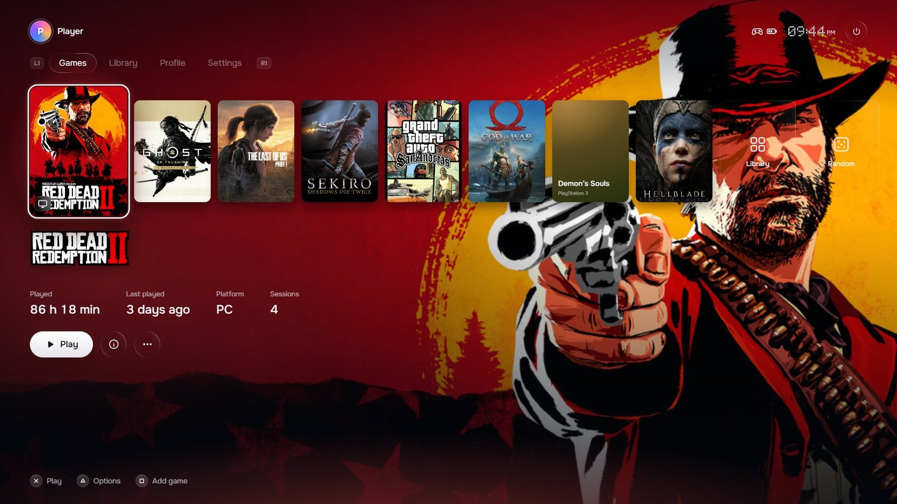

  <picture>
    <source media="(prefers-color-scheme: dark)" srcset="docs/assets/logo-dark.svg">
    
  </picture>

  
  
  
  

<a href="README.md">English</a> · <b>Русский</b>

**PlayOS** — игровой лаунчер с открытым исходным кодом, который превращает компьютер на Windows в приставку: одно место для всех ваших игр и полное управление геймпадом. PlayOS написан на TypeScript (Electron, React, Node.js), общается с Windows через koffi и с DualSense по HID, а игры PlayStation&nbsp;2 и PlayStation&nbsp;3 запускает через PCSX2 и RPCS3.

  <a href="https://github.com/fakem1nk/PlayOS/releases/latest"><b>Скачать для Windows</b></a>
  &nbsp;·&nbsp;
  <a href="#возможности">Возможности</a>
  &nbsp;·&nbsp;
  <a href="docs/FAQ.md">F.A.Q</a>
  &nbsp;·&nbsp;
  <a href="docs/BUG_REPORT.ru.md">Сообщить об ошибке</a>
  &nbsp;·&nbsp;
  <a href="docs/DEVELOPMENT.ru.md">Для разработчиков</a>

  

## Возможности

<table>
  <tr>
    <td width="50%" valign="top">
       
      <b>Одна библиотека для всего</b> 
      Игры PC и Steam, PlayStation&nbsp;2 через PCSX2 и PlayStation&nbsp;3 через RPCS3. Игры Steam и образы дисков находятся и узнаются сами.
    </td>
    <td width="50%" valign="top">
       
      <b>Создан под геймпад</b> 
      DualSense, DualShock&nbsp;4, Xbox, 8BitDo, Nintendo и старые геймпады DirectInput. Подсказки кнопок подстраиваются под геймпад в руках, клавиатура тоже работает.
    </td>
  </tr>
  <tr>
    <td width="50%" valign="top">
       
      <b>Меню поверх любой игры</b> 
      Кнопка PS или Guide ставит игру на паузу и открывает сохранения со скриншотами, громкость, вывод звука, яркость и заряд.
    </td>
    <td width="50%" valign="top">
       
      <b>Облачные сохранения</b> 
      Сохранения, библиотека, время в играх и профиль на Яндекс Диске, Google Drive или в папке синхронизации. Хранится до 30 версий каждого сохранения, после переустановки всё возвращается.
    </td>
  </tr>
  <tr>
    <td width="50%" valign="top">
       
      <b>Настоящие трофеи</b> 
      RetroAchievements для PS2 и достижения Steam для PC, с уведомлениями прямо поверх игры.
    </td>
    <td width="50%" valign="top">
       
      <b>Время и история</b> 
      Каждая сессия на счету, даже через сторонние лаунчеры. HowLongToBeat показывает, сколько игры уже пройдено.
    </td>
  </tr>
  <tr>
    <td width="50%" valign="top">
       
      <b>Живой главный экран</b> 
      Обложки, фоны и логотипы загружаются сами. Меню и подсветка DualSense берут цвет игры, а фон оживает трейлером.
    </td>
    <td width="50%" valign="top">
       
      <b>Готов к телевизору</b> 
      Выбор монитора для PlayOS и эмуляторов, масштаб интерфейса для дивана, тёмная и светлая темы, стриминг через Moonlight.
    </td>
  </tr>
</table>

## Участники

Хотите помочь? Начните с [руководства для разработчиков](docs/DEVELOPMENT.ru.md). Идеи и сообщения об ошибках ждём в [Issues](https://github.com/fakem1nk/PlayOS/issues/new/choose).

## Лицензия

PlayOS распространяется по лицензии [GPL-3.0](LICENSE).

PlayOS — независимый проект, не связанный с Sony Interactive Entertainment, Valve и Microsoft. PlayStation, DualSense, Steam и Xbox — товарные знаки их владельцев. Обложки на скриншоте принадлежат правообладателям игр. Эмуляторы, BIOS и игры в комплект не входят.
