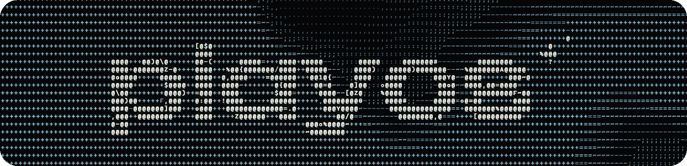
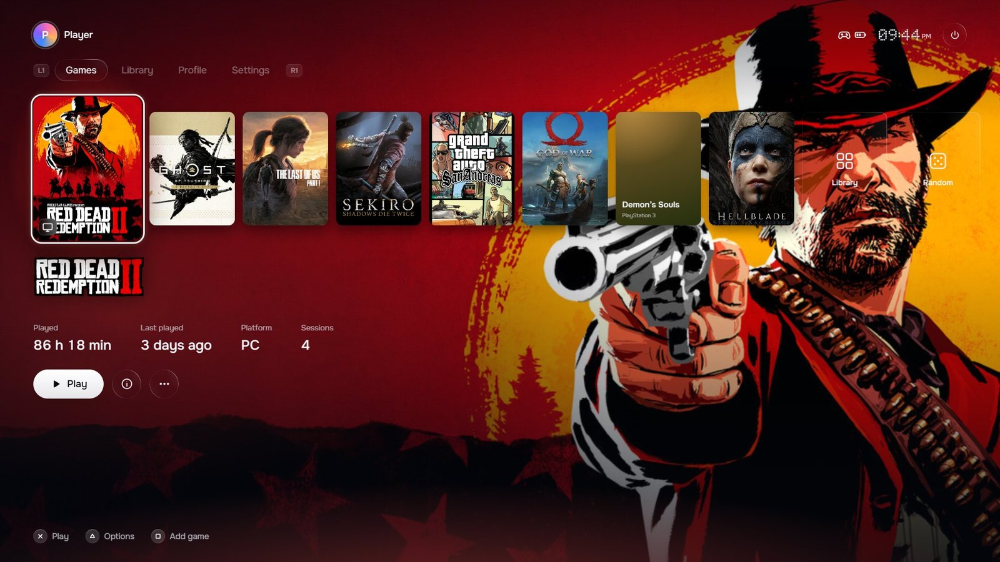

  <picture>
    <source media="(prefers-color-scheme: dark)" srcset="docs/assets/logo-ascii-dark.png">
    
  </picture>

  
  
  
  

<a href="README.md">English</a> · <b>Русский</b>

**PlayOS** — игровой лаунчер с открытым исходным кодом, который превращает компьютер на Windows в приставку: одно место для всех ваших игр — PC, Steam, PlayStation&nbsp;2, PlayStation&nbsp;3 и VR — с полным управлением геймпадом, меню поверх игры, облачными сохранениями и настоящими трофеями. Интерфейс на русском и английском.

PlayOS написан на TypeScript (Electron, React, Node.js). Он общается с Windows через koffi и с DualSense по HID, игры PlayStation&nbsp;2 и PlayStation&nbsp;3 запускает через PCSX2 и RPCS3, а VR-игры для PC — на Meta&nbsp;Quest через OpenComposite.

  <a href="https://github.com/fakem1nk/PlayOS/releases/latest"><b>Скачать для Windows</b></a>
  &nbsp;·&nbsp;
  <a href="#возможности">Возможности</a>
  &nbsp;·&nbsp;
  <a href="#с-чего-начать">С чего начать</a>
  &nbsp;·&nbsp;
  <a href="docs/FAQ.md">F.A.Q</a>
  &nbsp;·&nbsp;
  <a href="docs/BUG_REPORT.ru.md">Сообщить об ошибке</a>
  &nbsp;·&nbsp;
  <a href="docs/DEVELOPMENT.ru.md">Для разработчиков</a>

  

## Возможности

<table>
  <tr>
    <td width="50%" valign="top">
       
      <b>Одна библиотека для всего</b> 
      Игры PC и Steam, PlayStation&nbsp;2 через PCSX2, PlayStation&nbsp;3 через RPCS3 и VR-игры. Игры Steam, образы PS2 и список игр RPCS3 импортируются разом; для любой другой игры достаточно выбрать папку — PlayOS сам найдёт EXE. Поиск с геймпада, свои подборки, сортировка и удаление игр с компьютера прямо из PlayOS.
    </td>
    <td width="50%" valign="top">
       
      <b>Создан под геймпад</b> 
      DualSense, DualShock&nbsp;4, Xbox, 8BitDo, Nintendo и старые геймпады DirectInput — для необычных есть настройка кнопок. Подсказки подстраиваются под геймпад в руках и под то, что выбрано. Экранная клавиатура, вибрация в меню и прокрутка правым стиком на месте, а мышь и клавиатура делят один фокус с геймпадом.
    </td>
  </tr>
  <tr>
    <td width="50%" valign="top">
       
      <b>Меню поверх любой игры</b> 
      Кнопка PS или Guide, Select&nbsp;+&nbsp;Start или Ctrl&nbsp;+&nbsp;Alt&nbsp;+&nbsp;H ставят игру на паузу и открывают быстрые сохранения со скриншотами, время сессии, громкость, вывод звука, яркость и заряд геймпада. В PCSX2 сохранения попадают точно в нужный слот через PINE. Для отдельной игры меню можно выключить.
    </td>
    <td width="50%" valign="top">
       
      <b>VR-игры</b> 
      Отметьте любую игру для PC как VR-игру и играйте на Meta&nbsp;Quest по Link или Air&nbsp;Link. PlayOS сам скачает VR-компонент и подготовит его перед каждым запуском, хранит чёткость, руки, вибрацию и режим совместимости для каждой игры, а заряд шлема и контроллеров показывает в верхней панели.
    </td>
  </tr>
  <tr>
    <td width="50%" valign="top">
       
      <b>Облачные сохранения</b> 
      Сохранения, библиотека, время в играх и профиль на Яндекс Диске, Google Drive или в папке синхронизации. Сохранения игр PC находятся по базе Ludusavi, хранится до 30 версий каждого, а на новом компьютере всё возвращается. Удобнее файлом? Всё переносит одна копия <code>.playos</code>.
    </td>
    <td width="50%" valign="top">
       
      <b>Настоящие трофеи</b> 
      RetroAchievements для PS2 и достижения Steam для PC, в том числе в играх через эмуляторы Steam. Уведомление появляется в момент получения, а в списке трофеев остаётся скриншот этого момента. Каждый ключ PlayOS помогает получить по шагам.
    </td>
  </tr>
  <tr>
    <td width="50%" valign="top">
       
      <b>Время и история</b> 
      Каждая сессия на счету, даже через сторонние лаунчеры. На странице игры — история сессий, активность за две недели и HowLongToBeat; в профиле — игры, в которые вы играли больше всего, последние трофеи и собственные трофеи PlayOS.
    </td>
    <td width="50%" valign="top">
       
      <b>Живой главный экран</b> 
      Обложки, фоны и логотипы сами загружаются из Steam, SteamGridDB и Википедии. Меню и подсветка DualSense берут цвет игры, фон оживает беззвучным трейлером, а заставка с часами бережёт OLED-экраны.
    </td>
  </tr>
  <tr>
    <td width="50%" valign="top">
       
      <b>Готов к телевизору</b> 
      Выбор экрана для PlayOS и эмуляторов, масштаб интерфейса для дивана, тёмная, светлая или системная тема. PlayOS запускается вместе с Windows, дружит с Moonlight и ждёт в трее — вернуть его можно кнопкой PS.
    </td>
    <td width="50%" valign="top">
       
      <b>Не мешает играть</b> 
      Пока идёт игра, PlayOS выгружает свой интерфейс и работает в режиме эффективности Windows. Ошибки, трофеи и обновления ждут в центре уведомлений. Обновления скачиваются в фоне и приходят с коротким списком изменений на вашем языке, бета-версии — по желанию.
    </td>
  </tr>
</table>

## С чего начать

1. Скачайте `PlayOS-Setup-<версия>.exe` из [последнего релиза](https://github.com/fakem1nk/PlayOS/releases/latest) и запустите. Если SmartScreen остановит установку, нажмите «Подробнее» → «Выполнить в любом случае» ([почему так](docs/FAQ.md#windows-пишет-система-windows-защитила-ваш-компьютер)).
2. Короткая первая настройка спросит имя и язык, подключит облако, найдёт игры, подскажет путь к эмуляторам и поможет выбрать экран и громкость. Любой шаг можно пропустить и поменять потом в настройках.
3. Готово: дальше PlayOS обновляется сам.

| Чтобы играть | Что нужно |
| --- | --- |
| В игры PC и Steam | Windows 10 или 11, 64-бит |
| В игры PlayStation&nbsp;2 | [PCSX2](https://pcsx2.net), свой BIOS и образы дисков |
| В игры PlayStation&nbsp;3 | [RPCS3](https://rpcs3.net) и прошивка PS3 |
| В VR-игры | Meta&nbsp;Quest и приложение Meta Horizon Link |
| С подсветкой DualSense | [DSX](https://store.steampowered.com/app/1812620/DSX/) |
| С трофеями и обложками почти для всех игр | Бесплатные ключи RetroAchievements, Steam Web API и SteamGridDB (необязательно) |

Управление, настройка эмуляторов и частые проблемы — в [F.A.Q](docs/FAQ.md).

## Участники

Хотите помочь? Начните с [руководства для разработчиков](docs/DEVELOPMENT.ru.md). Идеи и сообщения об ошибках ждём в [Issues](https://github.com/fakem1nk/PlayOS/issues/new/choose).

## Лицензия

PlayOS распространяется по лицензии [GPL-3.0](LICENSE).

PlayOS — независимый проект, не связанный с Sony Interactive Entertainment, Valve, Microsoft и Meta. PlayStation, DualSense, Steam, Xbox и Meta&nbsp;Quest — товарные знаки их владельцев. Обложки на скриншоте принадлежат правообладателям игр. Эмуляторы, BIOS и игры в комплект не входят.
